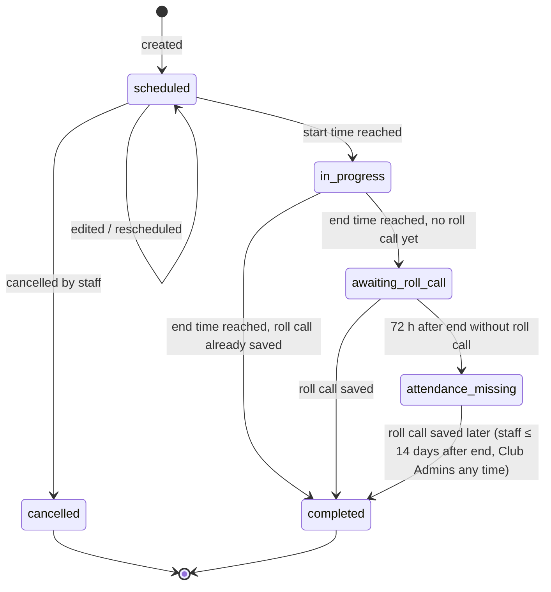

# F03 — Events, RSVP & Attendance

> Status: **Draft v0.1** · Release: **R1** (core) · Owner: Product · Last updated: 2026-10-22
> Source: Notion "Anotarse a las prácticas y partidos" · Related: [F02](F02-clubs-categories-and-membership.md) · [F04](F04-attendance-analytics.md) · [F10](F10-notifications.md) · OQ-07, OQ-16, OQ-22

## 1. Goal

Replace the WhatsApp "list" for practices and matches:
- Staff know **early** and **by position** who is coming.
- Players confirm in **one tap**.
- The club ends up with a **reliable record** of who actually attended.

This feature drives weekly engagement. Every other feature builds on it.

From the Notion brief:
- Coaches and DTs create a practice or match and send a link so players confirm attendance.
- Players, coaches and DTs see who is signed up, by position, and metrics such as attendance percentage.
- Notifications asking players to confirm can be automated.

Refinements made in this document:
1. **RSVP ≠ attendance.** A confirmation is an intention. Attendance metrics need staff to record who actually came (**roll call**). Without it, "attendance %" would really be "confirmation %".
2. **Recurring practices.** Amateur teams train on fixed weekdays. Creating every practice by hand would kill adoption.
3. **Match-specific data**: opponent, home/away, call time. Squad selection (*convocatoria*) is a separate step, planned for R3.
4. **Reasons and deadlines.** Absence reasons and an RSVP deadline give staff actionable information and enable "late change" alerts.
5. **Weekly agenda with bulk RSVP**, to fight notification fatigue.
6. **Proxy RSVP and managed profiles**, so the product works even when some players never install the app.

## 2. Scope

| In (R1) | R2 | R3 / Later |
|---|---|---|
| Practices, matches and "other" events | Calendar subscription (ICS feed) | Squad selection (*convocatoria*) (OQ-16) |
| One-off and weekly recurring events | Wellness flags in squad availability ([F07](F07-player-wellness.md)) | Match result and basic stats (OQ-16) |
| Multiple categories per event; individual call-ups | Backfilling past events (attendance only) | Staff RSVP / staff attendance (OQ-22) |
| RSVP in app, from a push action, from a shared link | | Carpooling, field booking, in-event chat (non-goals) |
| Deadlines, lock, reasons, arriving late, proxy RSVP | | |
| Squad availability by line, with warnings | | |
| Manual nudge; automated reminders (rules) | | |
| Roll call (offline-tolerant) | | |
| Edit, reschedule, cancel; agenda and weekly agenda | | |

## 3. Concepts and lifecycle

- Status is derived from timestamps and from the roll-call record. Only `cancelled` is stored as an explicit state.
- Roll call can be saved from 30 minutes before the start (BR-EVT-17), so it may already exist while the event is `scheduled` or `in_progress`; the event becomes `completed` when it ends.
- An `attendance_missing` event that nobody completes within 14 days stays `attendance_missing` for good (excluded from rates), unless a Club Admin records its roll call later.
- `attendance_missing` events are **excluded** from attendance rates ([F04](F04-attendance-analytics.md)) and listed in a data-quality reminder for staff.

### Event fields

| Field | Practice | Match | Other | Notes |
|---|---|---|---|---|
| Categories (1..n) | ✅ required | ✅ required | ✅ required | Staff can only pick categories where they are staff; Admins can pick any. |
| Title | default "Práctica" | default "vs {opponent}" | ✅ required | Editable. |
| Start (date and time) | ✅ | ✅ (= kickoff) | ✅ | Club time zone. |
| Duration / end | default from category | default by format | ✅ | BR-CLUB-14. |
| Call time (`meet_at`) | optional | default kickoff − 60 min | optional | Recomputed when the start changes (BR-EVT-13). |
| Venue | optional | recommended | optional | Saved venue or free text. |
| Opponent | — | ✅ required | — | Free text with club-level suggestions. |
| Home / away / neutral | — | ✅ | — | |
| Competition | — | optional | — | Free text with suggestions (e.g. "Liga – Fecha 7"). |
| Notes for players | optional | optional | optional | e.g. "Traer pechera y canilleras". Max 500 characters. |
| RSVP deadline | category default | category default | category default | Stored as an absolute time; recomputed when the start changes (BR-EVT-13). |
| Lock after deadline | category default | category default | category default | |
| Session plan | R2 ([F06](F06-session-planning.md)) | — | — | |

## 4. Business rules

### Creation and invitees
| ID | Rule |
|---|---|
| BR-EVT-01 | An event belongs to one club and is linked to at least one of its categories. Only staff of at least one linked category, or Club Admins, can create, edit or cancel it. |
| BR-EVT-02 | **Invitees** are generated when the event is created: every player (`is_player = true`) with an active membership on the event date in any linked category, de-duplicated, plus any individually added players (**call-ups**). Each invitee records its **source**: `category`, `call_up`, or `walk_in` (added during roll call, BR-EVT-20). An active membership on the event date means `starts_on` ≤ event date ≤ `ends_on` (or open), in the club time zone (BR-CLUB-06). |
| BR-EVT-03 | Invitee lists of future events are kept in sync with roster changes (BR-CLUB-05). Call-ups are never removed automatically. |
| BR-EVT-04 | Staff can remove an individual invitee, for example an injured player, from a future event. The player is notified (N-20) only if they had answered `going`. |
| BR-EVT-05 | **Recurring series**: weekly on one or more weekdays, with the same time, duration, venue, categories and settings, from a start date to an end date (max 12 months, required). All instances are materialized when the series is created. |
| BR-EVT-06 | Editing an instance of a series asks for the scope: **this event** or **this and following events**. "This and following" splits the series at that date. Instances already edited individually keep their overrides unless the edit changes the same field. |

### RSVP
| ID | Rule |
|---|---|
| BR-EVT-07 | RSVP values: `pending` (default), `going` or `not_going`. `going` may carry `arriving_late = true` and a note (≤ 140 characters). `not_going` **requires** a reason (`injury_illness`, `work_study`, `personal`, `travel`, `other`) and may carry a note. |
| BR-EVT-08 | Players can RSVP from the moment the event is created until it starts, or until roll call is first saved, whichever comes first. After that, only staff can change RSVPs (proxy). |
| BR-EVT-09 | **Deadline**: changes after the RSVP deadline are recorded as **late**. A change from `going` to `not_going` after the deadline triggers N-07 to the event's staff. If the event is **locked**, players cannot change their RSVP after the deadline; only staff can (proxy). |
| BR-EVT-10 | **Proxy RSVP**: staff can set or change any invitee's RSVP at any time before the event ends. The change is attributed to that staff member ("Confirmado por Martín"). The player is notified (N-21) only if their own answer was overwritten. |
| BR-EVT-11 | Every RSVP change is kept in an append-only history (who, when, from, to, reason, source: `app`, `push_action`, `web_link`, `weekly_agenda` or `proxy`). |
| BR-EVT-12 | **Visibility**: all invitees see the invitee list with each person's display name, photo, line and RSVP status (including "arriving late"). **Absence reasons and notes are visible only to staff of the event's categories, Club Admins and the player themselves.** |

### Changes and cancellation
| ID | Rule |
|---|---|
| BR-EVT-13 | Changing an event's **date or start time** asks staff "¿Pedir que vuelvan a confirmar?" (default **yes**). If yes, every RSVP returns to `pending` (history kept) and invitees get N-05 with a reconfirm call to action. If no, invitees get N-05 as information only. In both cases the **RSVP deadline and call time keep their offsets from the start** and are recomputed, unless staff edit them in the same change. If the recomputed deadline has already passed, it is set to the new start time, so nobody is locked out of reconfirming. |
| BR-EVT-14 | Changing the **venue** always notifies invitees (N-05). Changing notes, title or call time notifies them only if staff tick "Avisar a los jugadores". |
| BR-EVT-15 | **Cancelling** keeps the event visible as cancelled, notifies every invitee (N-06) with an optional message, and excludes it from all metrics. A cancelled event can be restored before its start time; restoring notifies invitees again (N-05, "restored" variant) and keeps their previous RSVPs. |
| BR-EVT-16 | An event can be **deleted** only if no invitee has responded and it is not part of a series' history; otherwise it must be cancelled. |

### Roll call
| ID | Rule |
|---|---|
| BR-EVT-17 | Roll call is possible from 30 minutes before start until **14 days after the end**. After that, only Club Admins can edit attendance. Saving roll call closes player RSVPs for the event (BR-EVT-08). |
| BR-EVT-18 | Roll call is pre-filled: `going` → `present` (or `late` if `arriving_late`); `not_going` and `pending` → `absent`. Staff confirm the list with one tap or adjust individual players. |
| BR-EVT-19 | Statuses: `present`, `late` or `absent`. For `absent`, `absence_justified` defaults to **true** if the player answered `not_going` before the deadline, and **false** otherwise (no response, late change or no-show). Staff can override it. |
| BR-EVT-20 | Players who were not invitees but showed up can be added during roll call as walk-ins. This adds them as invitees with source `walk_in` and status `present`. Analytics treat walk-ins like call-ups ([F04 § 3.3](F04-attendance-analytics.md#33-category-metrics-category-c)). |
| BR-EVT-21 | When two staff members edit roll call for the same event, each player's record is last-write-wins, and every change is audited. |
| BR-EVT-22 | Events still without roll call 72 hours after they end become `attendance_missing`. N-08 is sent to staff at the event end (+15 min) and again the next day at 10:00 if roll call is still missing. |

### Squad availability
| ID | Rule |
|---|---|
| BR-EVT-23 | The availability view groups invitees into **Going** (late arrivals included and marked), **Not going** and **Pending**. Within each group, players are ordered by line (GK, DEF, MID, FWD, no position) and then by display name. |
| BR-EVT-24 | Warnings shown to everyone: ⚠️ **"Sin arquero confirmado"** when no `going` player has GK as primary position; ⚠️ **"Faltan jugadores"** when `going` < the format's player count (11, 9, 8, 7, 5) for matches, or < the category's minimum-for-practice setting when one is set. |
| BR-EVT-25 | Counts per line use the player's **primary** position only. Secondary positions appear as small labels and do not count towards warnings. |

### Time
| ID | Rule |
|---|---|
| BR-EVT-26 | Times are stored as UTC instants and displayed in the **club's time zone**. If the device time zone differs, the time is labelled with the zone (e.g. "20:00 (hora de Montevideo)"). Series follow wall-clock time across daylight-saving changes. |

## 5. User stories

### EVT-01 · Create a practice
**Release:** R1 · **Priority:** Must · **Size:** M · **Platforms:** Mobile, Web

As a DT or Coach, I want to create a practice for one or more of my categories so that players know when and where to show up.

**Acceptance criteria**
- The form has the practice fields from § 3 with category defaults pre-filled. It can be completed in under 30 seconds on mobile.
- Selecting several categories shows the de-duplicated invitee count before saving ("Se invitará a 34 jugadores").
- After saving, invitees get N-01 (timing per [F10](F10-notifications.md)), and staff land on the event with a **Compartir** call to action (EVT-07).

### EVT-02 · Create recurring practices
**Release:** R1 · **Priority:** Must · **Size:** L · **Platforms:** Mobile, Web

As a DT, I want to set "Tuesdays and Thursdays at 20:00 until the end of November" once so that I never create practices one by one.

**Acceptance criteria**
- A "Se repite" option offers weekdays (multi-select) and an end date (required, ≤ 12 months; BR-EVT-05), and previews the number of events ("Se crearán 14 prácticas").
- Instances appear in the agenda immediately. Players are **not** notified about each instance at creation; they get the weekly agenda (N-02) and per-event reminders (N-03). Until EVT-18 ships (GA), the N-03 reminders alone cover series instances; this gap is accepted for α and β.
- Editing and cancelling instances follows BR-EVT-06 and BR-EVT-13–15, offering "esta" or "esta y las siguientes".
- The series can be extended ("Extender hasta…") without being recreated.

### EVT-03 · Edit or reschedule an event
**Release:** R1 · **Priority:** Must · **Size:** M · **Platforms:** Mobile, Web

As staff, I want to change an event's details so that players always have the right information.

**Acceptance criteria**
- Every field can be edited until the event ends.
- Notifications and RSVP resets follow BR-EVT-13 and BR-EVT-14. The confirmation dialog shows how many players will be notified.
- The event shows "Modificado" with a short change log (what changed, by whom, when) visible to invitees.

### EVT-04 · Cancel or restore an event
**Release:** R1 · **Priority:** Must · **Size:** S · **Platforms:** Mobile, Web

As staff, I want to cancel a practice (e.g. the field is flooded) so that nobody travels for nothing.

**Acceptance criteria**
- Cancelling asks for an optional message ("Suspendida por lluvia") and sends N-06 to all invitees immediately. If the event starts within 24 h, quiet hours are ignored.
- Cancelled events stay in the agenda, struck through with the message, and are excluded from metrics (BR-EVT-15).
- Restoring is possible before the start time.

### EVT-05 · Create a match
**Release:** R1 · **Priority:** Must · **Size:** M · **Platforms:** Mobile, Web

As a DT, I want to create a match with opponent, kickoff and call time so that players know where to be and when.

**Acceptance criteria**
- The form has the match fields from § 3. Call time defaults to 60 minutes before kickoff.
- Event cards show "vs Opponent · Local/Visitante · Citación 14:00 · Inicio 15:00".
- Opponent and competition suggest values used before in the club.

### EVT-06 · Call up players from other categories
**Release:** R1 · **Priority:** Must · **Size:** S · **Platforms:** Mobile, Web

As a DT, I want to invite specific players from other categories (e.g. two *Sub-20* players for a *Primera* practice) so that I have enough players.

**Acceptance criteria**
- "Invitar jugadores" searches the club directory (BR-CLUB-07) and adds the selected players as `call_up` invitees, who receive N-01 if the event is ≤ 7 days away ([F10](F10-notifications.md)).
- Call-ups show an "Invitado/a" badge with their home category in every list.
- Staff can remove a call-up before the event starts (BR-EVT-04).

### EVT-07 · Share the event link
**Release:** R1 · **Priority:** Must · **Size:** M · **Platforms:** Mobile, Web

As staff, I want to share a link in the WhatsApp group so that players can confirm from where they already are.

**Acceptance criteria**
- "Compartir" opens the native share sheet with a pre-formatted message, e.g. "⚽ Práctica Primera — mar 14/10 20:00 — Parque Rodó. Confirmá acá 👉 <link>".
- The link shows a rich preview (club crest, title, date and time, venue). Previews never include invitee names or any other personal data.
- The link has a short, unguessable token (≥ 10 random characters) and is valid until the event ends; after that it shows the event as finished.

### EVT-08 · RSVP in the app
**Release:** R1 · **Priority:** Must · **Size:** M · **Platforms:** Mobile, Web

As a player, I want to answer "Voy / No voy" in one tap so that my DT knows if I'm coming.

**Acceptance criteria**
- Event cards on Home and in the agenda show **Voy** and **No voy** buttons while the RSVP is `pending`, and the current answer with "Cambiar" afterwards.
- **No voy** opens a reason picker (BR-EVT-07): one tap on a reason chip plus an optional note.
- **Voy** offers an optional "Llego tarde" toggle with a note.
- The answer is saved optimistically. Without a connection it is queued and synced later (NFR-OFF-01), with a "pendiente de enviar" indicator.
- After the deadline, the UI shows "Cambio tardío: se le avisará al cuerpo técnico" before saving. If the event is locked, the buttons are disabled with "Las confirmaciones están cerradas; hablá con tu DT".

### EVT-09 · RSVP from a push notification
**Release:** R1 · **Priority:** Must · **Size:** M · **Platforms:** Mobile

As a player, I want to answer directly from the notification so that I don't even have to open the app.

**Acceptance criteria**
- N-01, N-02 (single-event case) and N-03 notifications have **Voy** and **No voy** actions on iOS and Android.
- **Voy** submits in the background and updates the notification, or confirms with a short system message where supported.
- **No voy** opens the app on the reason picker for that event (BR-EVT-07).
- If the background request fails, the app retries on next open and shows the queued state.

### EVT-10 · RSVP from the shared link
**Release:** R1 · **Priority:** Must · **Size:** L · **Platforms:** Web, Mobile

As a player tapping the link in WhatsApp, I want to land on the event and answer immediately.

**Acceptance criteria**
- If the app is installed, the link opens the event in the app (universal links / app links). Otherwise the web event page opens.
- Signed out on the web: the page shows the event summary (no invitee names) and sign-in options (F01). After sign-in it returns to the event and its RSVP buttons.
- Signed in and an invitee: the RSVP buttons and the squad availability (EVT-11) are shown.
- Signed in but not an invitee:
  - Member of a linked category but not invited (e.g. joined after start): shown "No estás invitado/a a esta actividad" with an option to ask staff.
  - Not a member: shown "Esta actividad es para **Primera** de **Club X**" with a **Solicitar unirme** action. It creates a join request through the category's default player link (CLUB-05), and always requires approval when it comes from an event link, whatever the link's own setting. If the event is linked to several categories, the user picks one. The action is hidden if the category is archived.
  - Staff of a linked category and Club Admins who are not invitees see the staff view of the event instead.
- After the first web RSVP, the page suggests installing the app for reminders.

### EVT-11 · See who's going, by position
**Release:** R1 · **Priority:** Must · **Size:** M · **Platforms:** Mobile, Web

As a player or staff member, I want to see who is going, grouped by position, so that I know whether the practice or match will work.

**Acceptance criteria**
- The event screen shows a summary bar ("Van 15 · No van 4 · Sin responder 7") and per-line counts for `going` ("ARQ 2 · DEF 5 · MED 5 · DEL 3").
- Grouping, ordering and warnings follow BR-EVT-23–25. Call-ups and "arriving late" are badged.
- Staff can expand **No van** to see reasons (BR-EVT-12) and **Sin responder** to nudge (EVT-13).
- The view refreshes when the screen gains focus, on pull-to-refresh and when an RSVP push arrives. Live updates are Later.

### EVT-12 · RSVP on behalf of a player
**Release:** R1 · **Priority:** Must · **Size:** S · **Platforms:** Mobile, Web

As staff, I want to set a player's answer when they tell me in person or by WhatsApp, or when they have no account, so that the list reflects reality.

**Acceptance criteria**
- From the invitee list, staff can set any RSVP value (with a reason for `not_going`).
- The change is attributed per BR-EVT-10 and appears in the history.

### EVT-13 · Nudge players who haven't answered
**Release:** R1 · **Priority:** Must · **Size:** S · **Platforms:** Mobile, Web

As a DT, I want to remind everyone who hasn't answered with one tap so that I stop chasing them individually.

**Acceptance criteria**
- "Recordar a los que no respondieron (7)" sends N-04 to `pending` invitees with an account.
- Pending managed profiles are listed separately with a "Copiar lista" action. It copies a WhatsApp-ready text ("Faltan confirmar: Juan, Pedro…") for staff to paste in the group.
- Rate limit: one nudge per event every 2 hours. The button shows when the last nudge was sent.

### EVT-14 · Automated reminders
**Release:** R1 · **Priority:** Must · **Size:** M · **Platforms:** Server

As a DT, I want reminders to go out automatically so that players answer without my intervention.

**Acceptance criteria**
- Default reminders follow the category settings (BR-CLUB-14) and are sent only to `pending` invitees: N-03 at start − 24 h and at deadline − 1 h, with the spacing rule in BR-NOTIF-13. Delivery rules (quiet hours, caps, de-duplication) are in [F10](F10-notifications.md).
- Reminders are rescheduled automatically when the event time changes, and cancelled when the event is cancelled or the invitee answers.
- Staff can turn automated reminders off for a single event.

### EVT-15 · Take attendance (roll call)
**Release:** R1 · **Priority:** Must · **Size:** L · **Platforms:** Mobile, Web

As staff at the field, I want to confirm who came in a few taps, even with poor signal, so that attendance stats are real.

**Acceptance criteria**
- "Pasar lista" is available in the window from BR-EVT-17 and is pre-filled per BR-EVT-18.
- Each player row cycles through **Presente → Tarde → Ausente** with one tap, with large touch targets for use outdoors. "Justificada" can be toggled on absences (BR-EVT-19).
- Walk-ins can be added (BR-EVT-20).
- Saving works offline: changes queue with idempotency keys and sync when connectivity returns (NFR-OFF-01). The screen shows the sync state.
- After saving, the event becomes `completed` when it ends (§ 3), and player RSVPs close (BR-EVT-08). Edits remain possible within the window.

### EVT-16 · Roll-call reminders and missing-attendance list
**Release:** R1 · **Priority:** Must · **Size:** S · **Platforms:** Mobile, Web, Server

As a DT, I want to be reminded to take attendance so that my stats don't have gaps.

**Acceptance criteria**
- N-08 is sent per BR-EVT-22.
- The staff home shows a "Falta pasar lista (2)" card linking to the events concerned. `attendance_missing` events stay in that list until 14 days after the event. After that they stay `attendance_missing` (excluded from rates) unless a Club Admin records the roll call.

### EVT-17 · My agenda
**Release:** R1 · **Priority:** Must · **Size:** M · **Platforms:** Mobile, Web

As a player or staff member, I want a list of my upcoming events so that I can plan my week.

**Acceptance criteria**
- The **Agenda** tab lists upcoming events in chronological order, grouped by day ("Hoy", "Mañana", "Jueves 16"), with type icon, time, title, category, venue and my RSVP status (players) or response counts (staff).
- It can be filtered by category and by type. Once AUTH-11 ships (GA), players see events from all their clubs; before that, the agenda shows the current club.
- A month view is available on web; mobile month view is Should.
- Past events are reachable through a "Anteriores" toggle.

### EVT-18 · Weekly agenda and bulk RSVP
**Release:** R1 · **Priority:** Should · **Size:** M · **Platforms:** Mobile, Web

As a player, I want to confirm all of next week's events at once so that I deal with the app once a week.

**Acceptance criteria**
- The weekly digest N-02 (one per player per club, at the earliest digest time among their categories in that club; default Monday 10:00) opens **"Tu semana"**: every event in the next 7 days with Voy / No voy for each and a "Confirmar todo" shortcut for "Voy". Reasons are still required for each "No voy".
- Events already answered are shown with their current status and can be changed.
- From R2, "Tu semana" also includes the pending wellness check-in (combined weekly ritual, [F07](F07-player-wellness.md)).

### EVT-19 · Subscribe to my calendar
**Release:** R2 · **Priority:** Should · **Size:** M · **Platforms:** Mobile, Web, Server

As a player, I want my events in Google Calendar or iOS Calendar so that I see them next to everything else.

**Acceptance criteria**
- Each user has a private ICS feed URL (revocable) containing their invited events, with cancellations reflected.
- "Agregar a mi calendario" explains the steps for Google and iOS.

### EVT-20 · Record a past event (backfill)
**Release:** R2 · **Priority:** Could · **Size:** S · **Platforms:** Web, Mobile

As a DT joining mid-season, I want to record past practices with attendance so that my stats start complete.

**Acceptance criteria**
- Staff can create an event with a past date. No notifications are sent, RSVP is skipped and roll call opens directly.
- Backfilled events are marked as such in analytics.

### EVT-21 · Squad selection for a match (*convocatoria*)
**Release:** R3 · **Priority:** Should · **Size:** L · **Platforms:** Mobile, Web

As a DT, I want to publish the list of selected players for a match, chosen from those available, so that everyone knows who is in the squad.

**Acceptance criteria**
- From a match, the DT selects players, from `going` by default but any invitee is allowed, up to a configurable maximum (default 18 for `f11`), and optionally marks starters.
- Publishing notifies selected and non-selected invitees with different copy. The selection is visible to invitees.
- Selection history is kept and available to analytics (selection rate per player).

## 6. Edge cases

| Case | Expected behavior |
|---|---|
| An event's categories are edited after creation | Invitees are recomputed per BR-EVT-02. New invitees get N-01 if the event is ≤ 7 days away ([F10](F10-notifications.md)). Removed invitees who had responded `going` get N-20. |
| A player was RSVP'd by proxy, then answers themselves | The player's answer wins. History shows both. |
| A player answers `going` and then their membership ends before the event | Removed per BR-CLUB-05 and notified (N-20), unless they are a call-up. |
| An event created for a time already in the past | Allowed only as a backfill (EVT-20) on R2. In R1 the form blocks past start times. |
| Two practices overlap for the same player (two categories) | Both are shown. The agenda marks the overlap with a ⚠️ icon. No blocking. |
| A practice at 08:00, where the reminder would fall in quiet hours | The reminder moves to the last slot before quiet hours ([F10](F10-notifications.md)). |
| A player has no position | Counted under "Sin posición". The player is prompted to set a position after their next RSVP. |
| A daylight-saving change during a series | Instances keep the local wall-clock time (BR-EVT-26). |

## 7. UX notes

- **Two taps maximum** from notification to confirmed RSVP. This is the product's most important interaction and should be prototyped and tested first.
- Event cards must be readable at a glance: type icon (whistle for practice, ball for match), weekday and time in large type, venue, and RSVP state as a colored chip (green Voy / red No voy / grey Sin responder).
- The goalkeeper warning is the one "wow" moment for DTs. Make it prominent.
- Roll call is used outdoors, often at night under floodlights: high contrast, big targets, one-handed.

## 8. Notifications triggered

N-01 Invitation · N-02 Weekly agenda · N-03 RSVP reminder · N-04 Manual nudge · N-05 Event changed · N-06 Event cancelled · N-07 Late drop-out (staff) · N-08 Roll-call reminder (staff) · N-20 Removed from an event · N-21 RSVP changed by staff. See [F10](F10-notifications.md) for timing, channels and defaults.

## 9. Telemetry

`event_created {type, categories_count, is_series, instances}`, `event_shared {channel}`, `rsvp_submitted {value, source, is_late, minutes_before_start}`, `rsvp_proxy_set`, `nudge_sent {recipients}`, `availability_viewed {role}`, `roll_call_saved {offline, duration_s, edited_rows}`, `event_cancelled {hours_before_start}`, `weekly_agenda_opened`, `bulk_rsvp_submitted {events}`.

## 10. Open questions

- **OQ-07** RSVP without an account? (Recommendation: no.)
- **OQ-16** When should squad selection and match results arrive?
- **OQ-22** Track staff attendance?
