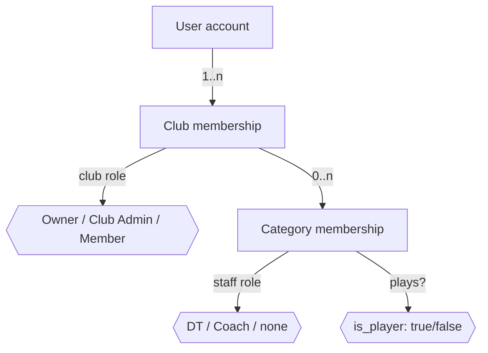

# Personas, Roles & Permissions

> Status: **Draft v0.1** · Owner: Product · Last updated: 2026-10-22
> Related: [Glossary](03-glossary.md) · [Open questions](05-open-questions.md) (OQ-01, OQ-09)

This document defines **who** uses the product and **what each role can do**. Every feature spec references the roles and scopes defined here; if a feature needs a permission that is not in the matrix below, update this document first.

---

## 1. Personas

Personas are composites based on how amateur and semi-professional clubs in the Río de la Plata region typically operate. They must be validated in pilot interviews (see [Roadmap § Pilot](04-scope-and-roadmap.md#5-pilot-plan)).

### P1 — Nico, the player

| | |
|---|---|
| **Profile** | 24 years old, plays in the *Primera* (first team) of an amateur club. Works or studies full-time and trains 2–3 evenings a week. Mid-range Android phone, prepaid data plan. Lives in WhatsApp. |
| **Goals** | Know when and where the next practice or match is. Confirm in seconds. Know what the practice will involve. Avoid being chased by the coach. |
| **Frustrations** | Scrolling a 200-message WhatsApp group to find the time and place. Typing "voy" in a list that someone else then overwrites. Not knowing whether enough teammates are going for the practice to be worth it. |
| **Success looks like** | Answers "Voy / No voy" straight from a notification. Never asks "¿a qué hora es?" again. |
| **Tolerance** | Very low. Anything longer than 30 seconds won't get done. Won't install an app "just because". |

### P2 — Martín, the DT (head coach)

| | |
|---|---|
| **Profile** | 38 years old, *Director Técnico* of the first team, paid little or nothing, coaches after a day job. Plans the week on Sunday night. Keeps attendance in a notebook or a spreadsheet. |
| **Goals** | Know by Monday who is available for the week, by position. Pick the squad for the weekend based on commitment. Spend practice time playing, not explaining drills. |
| **Frustrations** | Chasing players one by one. Finding out at the field that only 9 players showed up and there is no goalkeeper. Having no hard data when a player complains about not being picked. |
| **Success looks like** | Opens the app on Sunday and sees "Tuesday: 15 going — 2 GK, 5 DEF, 5 MID, 3 FWD". Selects the squad backed by an attendance table. |

### P3 — Sofi, the *profe* (fitness coach / assistant)

| | |
|---|---|
| **Profile** | 29 years old, *preparadora física* for three categories (Primera, Reserva, Sub-20). Has a degree in physical education. Sends routines and nutrition guides as PDFs in WhatsApp. |
| **Goals** | Manage training load and prevent injuries. Know who is in pain or overloaded before planning the session. Keep an organized library of exercises with videos. |
| **Frustrations** | Players don't read the PDFs. No consistent record of how players feel week to week. Every season the same exercises are explained from scratch. |
| **Success looks like** | Checks a squad wellness board on Monday, sees 3 flagged players, adapts Tuesday's session, and assigns them a recovery routine in two taps. |

### P4 — Laura, the club coordinator (club admin)

| | |
|---|---|
| **Profile** | 45 years old, volunteer board member / *delegada*. Responsible for several categories, league registrations and rosters. Mostly uses a laptop. |
| **Goals** | One place with every category, every coach and every player. Move players between categories as the season evolves. See which categories are healthy and which are struggling. |
| **Frustrations** | Rosters live in different coaches' phones. Nobody knows who actually plays where. |
| **Success looks like** | Sets up the club in an evening, shares one link per category, and has an up-to-date roster by the end of the week. |

### P5 — Guardian (secondary)

Parent or legal guardian of a player under 18 (e.g. a *Sub-20* player who is 17). Does not use the product day to day, but must give consent before the club collects health-related data from the minor (see [Privacy & compliance](06-privacy-and-compliance.md#4-minors)). No account is required in the MVP; consent is given through an emailed link.

---

## 2. Role model

The Notion brief defines three roles (Player, Coach/Profe, Technical Director). Refining them surfaced two problems:

1. **"DT" means something different locally.** In Río de la Plata football, *DT* (*Director Técnico*) is the **head coach of a team**, not a club-wide director. The brief, however, gives the DT club-wide powers (manage categories, assign any player, club-wide analytics). That is the job of a club coordinator.
2. **Roles are not global.** The same person is often a player in one category and a coach in another (a first-team veteran who coaches the Sub-20), or a coach in one club and a player in another.

**Proposed model** (pending confirmation in **OQ-01**). Roles are assigned at two levels:

| Level | Role | Scope | Summary |
|---|---|---|---|
| Club | **Owner** | Whole club | Created the club. Club Admin powers plus deleting the club and transferring ownership. Exactly one per club. |
| Club | **Club Admin** | Whole club | Club coordinator. Manages club settings, categories, all rosters and staff, and sees club-wide analytics. Optional for every member; a club can have several. |
| Category | **DT** (head coach) | Their categories | All coaching capabilities plus roster management (add, move and remove players) and category settings in the categories they lead. |
| Category | **Coach** (*profe*) | Their categories | Coaching capabilities: events, attendance, exercises, session plans, wellness, routines, nutrition and the AI assistant. Cannot change rosters: player invite links they create always require approval, and they cannot create managed profiles (BR-CLUB-08). Carries a free-text **staff title** shown in the UI (e.g. *Preparador físico*, *Ayudante técnico*, *Entrenador de arqueros*, *Fisio*, *Nutricionista*). |
| Category | **Player** | Their categories | Confirms attendance, sees squad lists and own metrics, accesses exercises, routines and nutrition, and submits wellness check-ins. |

**DT** and **Coach** are both **staff roles**. **Player** is modelled as a flag (`is_player`) on the category membership, so a staff member can also be a player in the same category (the common *jugador-entrenador* case) without a third "hybrid" role.

**Mapping from the Notion brief**

| Notion role | Maps to |
|---|---|
| Player | Player |
| Coach / Profe | Coach |
| Technical Director (DT) | **DT** for coaching and roster capabilities in their categories, plus **Club Admin** when they also manage the club. In small clubs both roles are held by the same person; onboarding grants both to the club creator by default. |

---

## 3. Scopes

Permissions in the matrix below are granted on a **scope**:

| Scope | Meaning |
|---|---|
| **Club** | Any resource in the club. |
| **Own categories** | Categories where the user holds the staff role in question (DT or Coach). For a resource linked to several categories (e.g. an event for Primera and Reserva), staff of **any** linked category may act on it unless a rule says otherwise. |
| **Invited** | Events where the user is an invitee. |
| **Self** | The user's own data. |
| **Assigned** | Content (routines, nutrition plans, session plans) assigned or published to the user, directly or through their categories. |

---

## 4. Permission matrix

Legend: ✅ allowed · 🔸 allowed with the limitation noted · — not allowed. Club Admin includes the Owner unless stated otherwise. The scope for DT and Coach is "own categories" unless stated otherwise.

### 4.1 Club and membership

| Capability | Owner | Club Admin | DT | Coach | Player |
|---|---|---|---|---|---|
| Edit club profile and settings | ✅ | ✅ | — | — | — |
| Delete club, transfer ownership | ✅ | — | — | — | — |
| Grant or revoke Club Admin | ✅ | 🔸 cannot remove the Owner | — | — | — |
| Create, rename or archive categories | ✅ | ✅ | — | — | — |
| Edit category settings (defaults, reminders, visibility) | ✅ | ✅ | ✅ | — | — |
| Create player invite links | ✅ | ✅ | ✅ | 🔸 approval always required (BR-CLUB-08) | — |
| Create staff invite links | ✅ | ✅ | 🔸 Coach role only | — | — |
| Approve or reject join requests | ✅ | ✅ | 🔸 player and Coach requests; DT requests need a Club Admin (BR-CLUB-09) | — | — |
| Add, move or remove players | ✅ | ✅ | 🔸 add any club member to own categories; move only between own categories; remove from own categories (CLUB-10) | — | — |
| Assign staff roles | ✅ | ✅ | 🔸 Coach role in own categories | — | — |
| Create managed (account-less) player profiles | ✅ | ✅ | ✅ | — | — |
| View the club member directory | ✅ | ✅ | ✅ | ✅ | — |
| View category squad list (names, positions, photos) | ✅ | ✅ | ✅ | ✅ | ✅ own categories |
| Remove a member from the club | ✅ | ✅ | — | — | — |
| Leave a club or category | ✅ (after transferring ownership) | ✅ | ✅ | ✅ | ✅ |

### 4.2 Events and attendance

| Capability | Owner / Admin | DT | Coach | Player |
|---|---|---|---|---|
| Create, edit or cancel events | ✅ any category | ✅ | ✅ | — |
| Add individual invitees (call-ups from other categories) | ✅ | ✅ | ✅ | — |
| RSVP | 🔸 only if they are an invitee | 🔸 only if they are an invitee | 🔸 only if they are an invitee | ✅ invited |
| RSVP on behalf of a player (proxy) | ✅ | ✅ | ✅ | — |
| See invitee list with RSVP status and "arriving late" | ✅ | ✅ | ✅ | ✅ invited |
| See absence reasons and notes | ✅ | ✅ | ✅ | 🔸 self only |
| Take or edit attendance (roll call) | ✅ any time | 🔸 until 14 days after the end (BR-EVT-17) | 🔸 until 14 days after the end (BR-EVT-17) | — |

### 4.3 Analytics

| Capability | Owner / Admin | DT | Coach | Player |
|---|---|---|---|---|
| Category attendance dashboard | ✅ all categories | ✅ | ✅ | 🔸 team aggregates only |
| Individual attendance of any player | ✅ | ✅ | ✅ | 🔸 self; teammates only if the category's ranking toggle is on (OQ-09) |
| Club-wide overview | ✅ | — | — | — |

### 4.4 Training content

| Capability | Owner / Admin | DT | Coach | Player |
|---|---|---|---|---|
| Create exercises in the club library | ✅ | ✅ | ✅ | — |
| Edit or archive any exercise | ✅ | ✅ | 🔸 own exercises only | — |
| Browse the full club library | ✅ | ✅ | ✅ | — (OQ-23) |
| View exercises included in published plans or assigned routines | ✅ | ✅ | ✅ | ✅ assigned |
| Create, edit and publish session plans | ✅ | ✅ | ✅ | — |
| View published session plans | ✅ | ✅ | ✅ | ✅ invited |
| Create and assign routines and nutrition plans | 🔸 individual assignments only if also staff of the player's category (BR-CONT-05) | ✅ | ✅ | — |
| View routines and nutrition plans | 🔸 individual content only if also staff of the player's category (BR-CONT-05) | ✅ | ✅ | ✅ assigned |

### 4.5 Wellness (health-related data)

| Capability | Owner / Admin | DT | Coach | Player |
|---|---|---|---|---|
| Configure the wellness schedule | 🔸 only if also staff | ✅ | ✅ | — |
| Submit a check-in | — | — | — | ✅ self |
| View individual check-ins | 🔸 **only if also staff of that player's category** | ✅ players of own categories | ✅ players of own categories | ✅ self |
| View squad aggregates (averages, response rate) | 🔸 only if also staff | ✅ | ✅ | — |

> Wellness data is health-related data. Club Admin status alone **never** grants access to individual wellness data; access requires a staff role in a category the player belongs to. See [Privacy & compliance § 3](06-privacy-and-compliance.md#3-health-related-data-wellness).

### 4.6 AI assistant

| Capability | Owner / Admin | DT | Coach | Player |
|---|---|---|---|---|
| Use the chat assistant and plan generator | 🔸 only if also staff | ✅ | ✅ | — |
| See club AI usage and quota | ✅ | — | — | — |
| Enable or disable AI for the club | ✅ | — | — | — |

The assistant only reads data the requesting user is allowed to see. See [F09](../features/F09-ai-coaching-assistant.md).

---

## 5. Role rules

| ID | Rule |
|---|---|
| BR-ROLE-01 | A user account can belong to any number of clubs. Each club membership is independent. |
| BR-ROLE-02 | A club membership can have any number of category memberships. Each category membership has at most **one** staff role (DT or Coach) and an independent `is_player` flag. |
| BR-ROLE-03 | A category membership must be either staff or player (or both); a membership that is neither is invalid. |
| BR-ROLE-04 | A category can have several DTs and several Coaches. A category without a DT is allowed, but the category settings show a warning to Club Admins. |
| BR-ROLE-05 | Every club has exactly one Owner. The Owner cannot leave or delete their account until ownership is transferred to another Club Admin, or the club is deleted. |
| BR-ROLE-06 | When a club is created, its creator becomes Owner and Club Admin. Onboarding asks whether they also coach a category; if so, they are made DT of that category. |
| BR-ROLE-07 | Permissions are evaluated on the server on every request, from the requester's current memberships. Clients only hide controls; they never enforce permissions. |
| BR-ROLE-08 | Role changes take effect immediately, are recorded in the audit log, and notify the affected member (N-18). |
| BR-ROLE-09 | A **managed profile** is a player created by staff without a user account. It can be invited, RSVP'd by proxy and marked in roll call. It cannot sign in, receive push notifications or submit wellness check-ins. A player claims it through a personal claim link, which attaches it to their account (see [F02](../features/F02-clubs-categories-and-membership.md)). |
| BR-ROLE-10 | Removing a member from a category ends that category membership: `ends_on` becomes yesterday (or `starts_on`, if the membership started today), so the person is no longer a member from today (BR-CLUB-06). Attendance and RSVP history is kept and still counts in that category's historical analytics. Wellness data follows least privilege: it is visible only to staff of categories where the player is **currently** active. |
