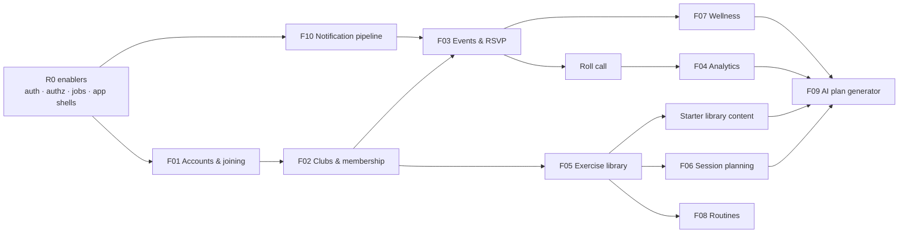

# Scope, Releases & Roadmap

> Status: **Draft v0.1** · Owner: Product · Last updated: 2026-10-22
> Story details live in the feature specs. The flat, prioritized list is the [Backlog](../delivery/backlog.md). Estimates are **product-owner planning estimates made before team estimation**: use them for sequencing, not for commitments.

## 1. Release overview

| Release | Theme | Goal | Features | Exit criteria |
|---|---|---|---|---|
| **R0** | Foundations | A deployable skeleton, the design system and the legal basics. Pilot clubs recruited. | Technical enablers (TECH-xx), prototypes and tests of Flows A–E, legal drafts | CI/CD green; staging live; auth spike done; prototype validated with ≥ 5 players and 3 DTs; ≥ 3 pilot clubs signed up |
| **R1** | **Squad & Attendance (MVP)** | Replace WhatsApp attendance lists and capture real attendance. | [F01](../features/F01-accounts-and-onboarding.md), [F02](../features/F02-clubs-categories-and-membership.md), [F03](../features/F03-events-and-attendance.md) (core), [F04](../features/F04-attendance-analytics.md) (core), [F10](../features/F10-notifications.md) (core) | Pilot targets in [Vision § 7](01-vision-and-strategy.md#7-success-metrics) for 6 consecutive weeks; security review done; store releases approved |
| **R2** | **Training Hub** | Make the app the home of training content and player wellness. | [F05](../features/F05-exercise-library.md), [F06](../features/F06-session-planning.md), [F07](../features/F07-player-wellness.md), plus calendar feed and backfill | Wellness coverage ≥ 70%; ≥ 40% of practices with a plan; ≥ 60 starter exercises; consent flows validated by counsel |
| **R3** | **Coach Pro** | AI planning that saves real time, and complete player programs. | [F08](../features/F08-routines-and-nutrition.md), [F09](../features/F09-ai-coaching-assistant.md), squad selection, exports, English | AI quality bar met ([F09 § 6](../features/F09-ai-coaching-assistant.md#6-quality-bar-acceptance-for-launch)); AI acceptance ≥ 50%; pricing decided and live |
| **Later** | Parking lot | Validated ideas, not scheduled | § 8 | — |

Why this order:
- **Attendance comes first.** It drives weekly engagement and creates the data and the habit everything else builds on.
- **Wellness and training content come before AI.** The AI needs a populated library, session history and squad-state data to be better than a generic chatbot.
- **Routines and nutrition come in R3.** They are valuable but mostly content distribution. They reuse the exercise library (R2) and are less critical for weekly engagement.

## 2. R0 — Foundations (≈ 3–4 weeks)

| Track | Items |
|---|---|
| Engineering | TECH-01 to TECH-10, TECH-14, TECH-15 (see [Backlog § 2](../delivery/backlog.md#2-technical-enablers)); ADR decisions 001–008 and 011–017; R0 spikes from [Tech stack § 8](../tech/00-tech-stack.md#8-r0-spikes-risks-to-retire-before-r1-development) |
| Design | Prototype of Flows A–E and the event link landing; design system foundations ([UX § 8](../ux/01-information-architecture-and-flows.md#8-design-deliverables-before-r1-development)) |
| Product | Answers to the **blocking** open questions (OQ-01, 02, 05, 06, 07, 08, 15, 18); pilot recruitment; competitor deep-dive; final name (OQ-03) |
| Legal | Terms, privacy policy, club terms and DPA model; controller/processor decision ([Privacy § 8](06-privacy-and-compliance.md#8-controller-and-processor-roles)) |

## 3. R1 — Squad & Attendance (MVP)

R1 is large: about 62 stories, ≈ 215 dev-days of feature work plus about 75 dev-days of enablers. It ships in three milestones so that real clubs use it as early as possible.

### R1-α · Closed alpha (internal team + 1 friendly club)
The smallest loop that replaces the WhatsApp list.
- **Accounts and joining**: AUTH-01, AUTH-02, AUTH-03, AUTH-04, AUTH-05, AUTH-06, AUTH-08, AUTH-10.
- **Club structure**: CLUB-01, CLUB-03, CLUB-05, CLUB-06, CLUB-07, CLUB-08, CLUB-09, CLUB-14.
- **Events and attendance**: EVT-01, EVT-02, EVT-05, EVT-08, EVT-11, EVT-12, EVT-14, EVT-15, EVT-17.
- **Notifications and stats**: NOTIF-01, NOTIF-02, ANL-01.
- Distribution: internal builds (TestFlight internal / Play internal testing).

### R1-β · Pilot (3–5 clubs)
Everything needed to run real clubs for a season.
- **Accounts**: AUTH-09, AUTH-13.
- **Club management**: CLUB-02, CLUB-04, CLUB-10, CLUB-11, CLUB-12, CLUB-17.
- **Events**: EVT-03, EVT-04, EVT-06, EVT-07, EVT-09, EVT-10, EVT-13, EVT-16.
- **Analytics**: ANL-02, ANL-03, ANL-04, ANL-05, ANL-07.
- **Notifications**: NOTIF-03, NOTIF-05.
- Distribution: external TestFlight and Play closed testing. Terms, privacy and in-app account deletion are live.

### R1-GA · General availability
Polish and scale.
- AUTH-07, AUTH-11, AUTH-12, CLUB-13, CLUB-15, EVT-18, ANL-06, ANL-08, ANL-09, NOTIF-04, NOTIF-06.
- TECH-16 (load test) and TECH-17 (security review).
- Public store releases.

### Scope levers (if the pilot date matters more than scope)
1. **Alpha with email-code sign-in only.** Google and Apple sign-in move to the pilot milestone. App Store guideline 4.8 applies only once third-party sign-in is offered.
2. **Player web limited to the link landing + RSVP + join.** The full player web experience moves to GA.
3. **Series editing limited to "this event"** in alpha. "This and following" moves to the pilot.
4. **Analytics breakdowns** (by line, by weekday) move to GA if needed. The per-player table stays in the pilot (DTs need it for selection).

## 4. R2 — Training Hub

| Priority | Stories |
|---|---|
| Must | EXR-01–07, PLAN-01–05, WELL-01–06, WELL-08, WELL-09, WELL-12 |
| Should | EXR-08 (starter library), EXR-09, PLAN-06–08, WELL-07, WELL-10, WELL-11, EVT-19 |
| Could | CLUB-16, EVT-20 |
| Enablers | TECH-12 (back-office UI), TECH-13 extension for wellness retention (BR-WELL-15; the base purge jobs ship in R1-β), TECH-18 (video provider, ADR-009), TECH-20 (only if analytics performance requires it) |

Sequencing inside R2:
1. **Wellness first.** It is independent of content, gives fast value to *profes*, and completes the "Tu semana" ritual.
2. **Then the exercise library and the starter library**, in parallel with content production (OQ-13).
3. **Then session planning.**

## 5. Pilot plan

| Topic | Plan |
|---|---|
| Clubs | 3–5 clubs, 8–15 categories in total. Mix of formats (at least one futsal or F7 team), at least one women's category, and at least one *Sub-20* with players under 18 (to exercise guardian consent in R2). |
| Selection criteria | An engaged champion (DT or coordinator); currently uses WhatsApp lists; trains ≥ 2× per week; willing to give weekly feedback. |
| Duration | R1-β for **8 weeks**, continuing as the R2 beta. |
| Onboarding | A white-glove setup session (≈ 1 h per club, done together): categories, managed profiles, recurring practices, link sharing. |
| Support | A WhatsApp support group with pilot staff, plus an in-app feedback link and a weekly 20-minute call per club. |
| Measurement | Metrics in [Vision § 7](01-vision-and-strategy.md#7-success-metrics) from analytics. Interviews at weeks 2, 4 and 8 (DTs, *profes*, 3–5 players per club). Staff and player NPS at week 8. Time-saved survey. Willingness-to-pay questions at week 8. |
| Incentive | Free use during the pilot and the first season after launch; "club fundador" badge. |
| Go / no-go for GA | Pilot targets met for 6 consecutive weeks in ≥ 70% of pilot categories; no open P1 bugs; security review completed; legal texts approved. |

## 6. Estimates and team assumptions

| Item | Planning estimate |
|---|---|
| Team assumed | 3 full-stack TypeScript developers (one mobile-leaning), 1 part-time product designer, product owner, part-time QA from the pilot onwards |
| R0 | 3–4 weeks |
| R1 total | ≈ 290 dev-days (≈ 215 features + ≈ 75 enablers) → **≈ 5–6 months to GA** with 3 developers. Alpha at ≈ month 3, pilot at ≈ month 4. |
| R2 | ≈ 115 dev-days plus enablers → ≈ 2.5–3 months |
| R3 | ≈ 105 dev-days plus enablers → ≈ 2.5–3 months |

Size key: S ≈ 1.5, M ≈ 4, L ≈ 8 and XL ≈ 15 dev-days (midpoints). The team re-estimates during backlog refinement; this table is updated afterwards.

## 7. Dependencies and critical path

External dependencies:
- Apple and Google developer accounts and store review lead times.
- The legal review ([Privacy § 13](06-privacy-and-compliance.md#13-legal-deliverables)).
- Starter library content (OQ-13).
- The video provider contract (ADR-009).
- The AI provider DPA (R3).

## 8. Later (parking lot)

| Idea | Why it's interesting | Related |
|---|---|---|
| Fee collection (*cuotas*) and payments | A top admin pain and a monetization path | OQ-17 |
| Medical clearance (*ficha médica*) expiry tracking | Common requirement in leagues; a compliance pain for clubs | OQ-17 |
| WhatsApp Business notifications | Reach players without the app | OQ-20 |
| Match stats (goals, minutes, cards) and "performance" analytics | Mentioned in the overview, but undefined | OQ-16 |
| Seasons and season rollover | Cleaner analytics and roster resets | OQ-19 |
| Match results | Context for attendance and selection; needed before any "performance" analytics | OQ-16 |
| Audit-log viewer for Club Admins | Transparency for roster and role changes (the log itself exists from R1) | F02 |
| Configurable at-risk and wellness-flag thresholds | Per-category tuning once pilots show the fixed values don't fit | F04, F07 |
| Staff attendance and RSVP | Some clubs track staff too | OQ-22 |
| Session RPE and load monitoring (sRPE, ACWR) | A natural evolution of wellness | OQ-10 |
| Guardian-managed accounts (youth under 16) | A large adjacent market | OQ-05 |
| Tactical board / diagram editor | Better exercise content | F05 |
| Weekly AI digest for staff | Proactive insights | F09 |
| Web push for staff | Desktop reminders | F10 |
| Live updates (websockets) for availability | Nicer real-time feel | F03 |
| Self-service data export, account merge | Privacy rights at scale | F01 |
| League and fixture integrations | Auto-create matches | — |
