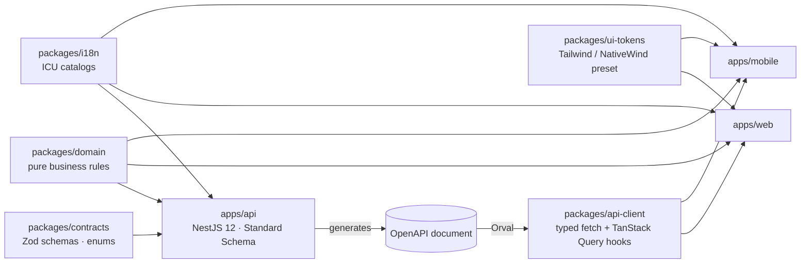

# Tech Stack

> Status: **Proposed v0.1**. Recommended stack, to be confirmed in R0 (OQ-15, [ADR log](adr-log.md)). · Last updated: 2026-10-23
> Related: [Architecture overview](01-architecture-overview.md) · [API guidelines](03-api-guidelines.md) · [AI architecture](04-ai-architecture.md) · [NFRs](05-non-functional-requirements.md)

**In one sentence**: a TypeScript monorepo with three apps that share contracts and business rules:
- an **Expo (React Native)** mobile app,
- a **Next.js** web app, and
- a **NestJS** modular-monolith API on **PostgreSQL**, with a Postgres-backed job queue and a REST + OpenAPI contract.

## 1. At a glance

| Layer | Mobile app (`apps/mobile`) | Web app (`apps/web`) | Backend (`apps/api`) |
|---|---|---|---|
| Language / runtime | TypeScript · React Native (New Architecture, Hermes) | TypeScript · React | TypeScript · Node.js (Active LTS) |
| Framework | **Expo** (managed workflow, development builds) + **Expo Router** | **Next.js** (App Router) | **NestJS** (modular monolith) |
| UI | **NativeWind** (Tailwind for RN) + own primitives on shared tokens | **Tailwind CSS** + **shadcn/ui** (Radix primitives) | — |
| Server state / data | **TanStack Query** + generated client, persisted cache, offline mutations | **TanStack Query** (portal) · Server Components (public pages) | **Prisma** on **PostgreSQL** |
| Validation / contracts | Zod schemas from `packages/contracts` | Zod schemas from `packages/contracts` | Zod → OpenAPI (NestJS 12 Standard Schema) |
| Forms | React Hook Form + Zod | React Hook Form + Zod | — |
| i18n | FormatJS (`react-intl`) + `expo-localization` | `next-intl` | ICU templates for push and email |
| Background work | Background notification actions | — | **pg-boss** + transactional outbox |
| Observability | Sentry (`@sentry/react-native`) · PostHog | Sentry (`@sentry/nextjs`) · PostHog | Sentry (`@sentry/nestjs`) · Pino logs |
| Delivery | EAS Build / Submit / Update | Vercel | Containers in São Paulo |

Shared across all three: `packages/contracts` (Zod), `packages/domain` (pure business rules), `packages/i18n` (ICU catalogs), `packages/ui-tokens` (design tokens), `packages/api-client` (generated client), `packages/config` (tsconfig, ESLint, Prettier).

## 2. Backend

| Layer | Choice | Why it fits this product |
|---|---|---|
| Language / runtime | **TypeScript on Node.js (Active LTS)** | One language with the Expo and Next.js apps. Validation schemas, types and business rules (attendance %, wellness flags, RSVP deadlines) are written once and shared through the monorepo. |
| Framework | **NestJS 12** (ESM) | Clear modules, so clubs, events, wellness and AI stay separate ([Architecture § 4](01-architecture-overview.md#4-backend-modules-bounded-contexts)). Guards fit the role and category permission checks. Dependency injection makes business rules easy to test. Fastify is a lighter alternative but needs more structure built by hand. |
| API style | **REST + OpenAPI**, with schemas defined in **Zod**, validated and turned into OpenAPI by NestJS 12's native Standard Schema support | Old mobile app versions stay in use for months, and an explicit, versioned contract handles that better than tRPC or GraphQL. A typed API client is generated for both web and mobile (§ 5). |
| Database | **PostgreSQL 18** (managed, with point-in-time recovery; local Docker Compose and CI's Testcontainers run the same major) | The data is relational: clubs → categories → memberships → events → RSVPs. Built-in full-text search with Spanish support (`unaccent`, `pg_trgm`) covers the exercise library. `pgvector` is available later if needed. |
| ORM | **Prisma** (Drizzle if the team prefers SQL-first) | Mature migrations and good developer experience. Analytics queries that need hand-written SQL use Prisma's typed raw queries. |
| Background jobs | **pg-boss** (a queue that lives in Postgres) | Reminders, weekly digests, wellness cycles, roll-call nudges and scheduled plan publishing all need reliable scheduling. `startAfter` covers scheduled sends and `singletonKey` covers de-duplication (BR-NOTIF-03). No Redis in the MVP; move to BullMQ + Redis only if volume demands it. |
| Reliability pattern | **Transactional outbox + idempotent jobs** | Side effects are recorded in the same transaction as the change that causes them. That keeps them crash-safe, and no notification is sent twice. |
| Auth | **Self-hosted auth library** (e.g. Better Auth) **vs. a managed service** (e.g. Clerk), decided by a short spike (ADR-007) | Sign-in with Google, Apple and email codes. Per-user pricing from a managed provider hurts when most users are low-value player accounts. |
| Authorization | NestJS **guards** + a central **policy module** (`can(actor, action, resource)`) + tenant-scoped repositories | Implements the [permission matrix](../product/02-personas-and-roles.md#4-permission-matrix) in one place (NFR-SEC-02/03). |
| Idempotency and rate limiting | Idempotency interceptor (keys stored in Postgres, 24 h) · `@nestjs/throttler` with a **Postgres-backed store** (or edge rate limiting) | Required for offline retries (NFR-OFF-01). Avoids adding Redis just for counters. |
| Push | **Expo Push Service** (`expo-server-sdk`) | Cheap and simple; wraps APNs and FCM, with receipts for token cleanup. |
| Email | **Postmark or Resend**, templates in **React Email** | Transactional deliverability; templates written as components and localized via ICU. |
| Storage | **S3-compatible storage (e.g. Cloudflare R2)** via AWS SDK v3 presigned URLs | Direct uploads from the apps, cheap egress. |
| Uploads security | Type and size checks, image re-encoding, ClamAV-based scanning in the worker | NFR-SEC-08. |
| AI | **Official Anthropic TypeScript SDK** (`@anthropic-ai/sdk`) | Tool use and structured outputs for plan generation ([AI architecture](04-ai-architecture.md)). |
| Logging / errors | **Pino** (`nestjs-pino`) with redaction · **Sentry** | Structured logs with request, club and user IDs. Sensitive fields are never logged (NFR-OBS-02). |
| Backend tests | **Vitest** + **Supertest** + **Testcontainers** (real Postgres) | Mandatory backend tests for domain rules, endpoints, authorization and tenant isolation (NFR-MAINT-01). |
| Hosting | API and worker containers in a **São Paulo** region | Lowest latency to Uruguay and Argentina (ADR-011). The API and worker are the same image run as two process types. |

## 3. Web app

| Concern | Choice | Notes |
|---|---|---|
| Framework | **Next.js (App Router)** | Server Components and SSR for the **public pages** (event and invite landings with Open Graph tags for WhatsApp previews, generated OG images via `next/og`). Client components for the authenticated staff portal. Also serves the universal-link association files. |
| Styling and components | **Tailwind CSS** + **shadcn/ui** (Radix primitives) | Accessible primitives (NFR-A11Y-01), with components owned in the repo. Theme colors come from `packages/ui-tokens` (club theming as CSS variables). |
| Server state | **TanStack Query** with hooks from `packages/api-client` | Caching, optimistic updates (RSVP, roll call), refetch on focus (no realtime in R1). |
| Session | httpOnly, Secure, SameSite cookies on the shared parent domain (`app.` / `api.` subdomains) | Final shape decided in the auth spike (TECH-04). No tokens in `localStorage`. |
| Forms | **React Hook Form** + Zod resolver | The same Zod schemas as the API. |
| Tables | **TanStack Table** | Member directory, per-player attendance table, wellness board. |
| Charts | **Recharts** | Attendance trends and breakdowns. Always labelled with numerator and denominator (BR-ANL-04). |
| Drag and drop | **dnd-kit** | Plan builder (PLAN-01) and reordering media and items. |
| Rich text (R3) | **Tiptap** | Nutrition plans and long descriptions. Stored as JSON. |
| i18n | **next-intl** reading the ICU catalogs in `packages/i18n` | Río de la Plata Spanish first, English in R3. |
| Dates and time zones | **date-fns** + **@date-fns/tz** | Club time zone display (BR-EVT-26). |
| Observability | `@sentry/nextjs`, `posthog-js` | With privacy filters (NFR-OBS-05). |
| Hosting | **Vercel** | Preview deployments per PR; edge caching for public pages. |

## 4. Mobile app

| Concern | Choice | Notes |
|---|---|---|
| Framework | **Expo** (latest SDK at R0) with **development builds** (not Expo Go), Continuous Native Generation + config plugins | Native modules are needed (Google sign-in, compression, PDF). React Native New Architecture and Hermes. |
| Navigation and deep links | **Expo Router** | File-based routes. Universal links (iOS associated domains) and verified App Links (Android) for `/e/…`, `/j/…`, `/c/…` (NFR-COMP-03). |
| Styling | **NativeWind** + own component primitives | The same Tailwind mental model as web. Tokens come from a shared Tailwind preset in `packages/ui-tokens`. Supports dark mode and high-contrast field screens (NFR-A11Y-04). |
| Server state and offline | **TanStack Query** + a persisted cache on **react-native-mmkv** · **paused mutations** persisted and resumed on reconnect, each carrying an `Idempotency-Key` | Offline reads (NFR-OFF-02) and the offline write queue for RSVP, roll call, check-ins and routine logs (NFR-OFF-01), without a custom sync engine. |
| Local UI state | **Zustand** | Selected club and category, UI preferences. |
| Secure storage | **expo-secure-store** | Refresh tokens in the Keychain / Keystore (NFR-SEC-11). |
| Sign-in | `@react-native-google-signin/google-signin` · `expo-apple-authentication` · email-code screens | Final integration depends on ADR-007. |
| Push | **expo-notifications** with notification **categories and actions** (Voy / No voy) | Background handling of the "Voy" action must be validated on iOS and Android in R0 (spike, § 8). |
| Lists | **@shopify/flash-list** | Roll call, member directory, agenda. |
| Gestures, animation, sheets | **react-native-reanimated**, **react-native-gesture-handler**, **@gorhom/bottom-sheet** | Reason picker, filters, drag handles in the plan builder. |
| Media capture | **expo-image-picker**, **expo-camera** (quick capture), **expo-image-manipulator** (photo resize), **react-native-compressor** (video) | Client-side compression before upload (BR-EXR-05, NFR-DATA). |
| Media display | **expo-image** (caching) · **expo-video** (HLS playback, no autoplay on cellular) | NFR-DATA-01/02. |
| Uploads | Presigned uploads with progress via `expo-file-system`; resumable direct uploads to the video provider (R2) | Retries and progress UI (EXR-02/03). |
| Documents (R3) | **expo-document-picker** · **react-native-pdf** | Routine and nutrition attachments, viewable offline (BR-CONT-09). |
| Charts | **victory-native** (Skia) | My stats, attendance trends, wellness history. |
| Body map (R2) | **react-native-svg** | Tappable front and back body regions (WELL-05). |
| Forms | React Hook Form + Zod | Shared schemas. |
| i18n | **FormatJS** (`react-intl`) + `expo-localization`, ICU catalogs from `packages/i18n` | Intl polyfills where Hermes needs them. |
| Dates | date-fns + @date-fns/tz | Same as web. |
| Observability | `@sentry/react-native`, `posthog-react-native` | Crash-free target (NFR-OBS-01). |
| Builds and releases | **EAS Build**, **EAS Submit**, **EAS Update** with channels (`preview`, `staging`, `production`) and the **fingerprint** runtime-version policy | OTA updates only reach compatible binaries. Minimum-version enforcement via `app-config` (TECH-14). |

## 5. Shared packages and contract flow

- **Contract-first**: a change to an endpoint starts in `packages/contracts`. The API validates with the same schemas, CI regenerates the OpenAPI document and the client, and fails on breaking changes to `v1` (NFR-MAINT-03).
- **Client generation**: **Orval** generates the typed fetch client and TanStack Query hooks. A thin wrapper adds auth headers, `X-App-Version`, `Idempotency-Key` and problem+json error mapping. Alternative: `openapi-typescript` + `openapi-fetch`, with hand-written hooks.
- **`packages/domain`** holds framework-free logic used by the API, and by clients where they need the same answer offline: metric formulas, wellness flag rules, RSVP deadline and late-change logic, quiet-hours shifting. It is fully unit-tested.

## 6. Infrastructure and third-party services

| Need | Choice (proposed) | Release |
|---|---|---|
| Web hosting | Vercel | R0 |
| API + worker hosting | Container platform with a São Paulo region (e.g. Fly.io, AWS ECS/Fargate, Google Cloud Run) | R0 |
| Database | Managed PostgreSQL 18 in São Paulo (e.g. Neon, Supabase, RDS) with PITR | R0 |
| Object storage | Cloudflare R2 (S3-compatible) | R1 |
| Push | Expo Push Service → APNs / FCM | R1 |
| Email | Postmark or Resend | R1 |
| Errors / performance | Sentry | R0 |
| Product analytics and feature flags | PostHog | R0 |
| Video | Mux or Cloudflare Stream (ADR-009) | R2 |
| LLM | Anthropic Claude API (ADR-010) | R3 |
| Secrets | The hosting platforms' secret managers | R0 |

## 7. Tooling and quality

| Concern | Choice |
|---|---|
| Monorepo | **pnpm** workspaces + **Turborepo** (remote cache in CI) |
| Runtime and package manager | Node.js 24 LTS and pnpm 12, pinned in `devEngines` (pnpm downloads both when missing) and `.nvmrc`. Shared versions live in the pnpm catalog; new releases are installable after 24 h (`minimumReleaseAge`) |
| Language settings | TypeScript `strict` everywhere; shared `tsconfig` presets |
| Lint and format | ESLint (flat config) + Prettier, shared from `packages/config` |
| Commits | Conventional Commits enforced with **commitlint** |
| CI | GitHub Actions: lint, typecheck, backend tests (Testcontainers Postgres), builds, OpenAPI breaking-change check, dependency scanning |
| Dependency updates | **Renovate**, with exact version pinning; versions are chosen at R0 (latest stable of each) |
| Backend tests | Vitest + Supertest + Testcontainers (mandatory, NFR-MAINT-01) |
| Frontend tests | **None at unit or component level** (team standard, NFR-MAINT-02) |
| End-to-end (QA-owned, once QA is staffed) | **Playwright** (web) and **Maestro** (mobile) for critical flows: sign-in, RSVP from a link, roll call, check-in |
| Local development | Docker Compose (Postgres); seed script with synthetic clubs; Expo development build; `.env` templates without secrets |

### Versions held below latest

Chosen at TECH-01 (2026-10-23). Lift a hold when its condition is met, in its own PR.

| Tool | Held at | Latest | Why | Lift when |
|---|---|---|---|---|
| TypeScript | 6.0 | 7.0 | typescript-eslint supports `<6.1` and `@nestjs/swagger` 12 supports `^6.0`. Expo SDK 58 also ships 6.0. | Both support 7 |
| ESLint | 9.39, deprecated upstream | 10 | `eslint-plugin-react`, used by `eslint-config-next` and `eslint-config-expo`, crashes on ESLint 10 (eslint-plugin-react #3977, next.js #89764) | Both configs support 10 |
| Node.js | 24, Active LTS | 26, LTS from late October 2026 | Vercel, EAS and the container host must support it first | All three support 26 |

## 8. R0 spikes (risks to retire before R1 development)

| Spike | Question | Outcome feeds |
|---|---|---|
| Auth | Does a self-hosted library (e.g. Better Auth) cover native Google and Apple sign-in on Expo, email codes, refresh rotation, and cookie sessions for Next.js against a NestJS API? What would a managed provider cost at 25k MAU? | ADR-007, TECH-04 |
| Actionable push | Can "Voy" from a notification submit in the background (app killed or backgrounded) on iOS and Android with expo-notifications? | EVT-09, NOTIF-05 |
| In-app browsers | Does WhatsApp open links in an in-app browser that blocks Google OAuth, on each OS? | NFR-COMP-04, AUTH-01 |
| Offline queue | Do TanStack Query paused mutations, persisted with MMKV, survive app restarts and replay idempotently? | NFR-OFF-01, EVT-15 |
| ORM | Prisma vs. Drizzle on the RSVP + roll call slice, plus one analytics query | ADR-013 |
| Shared tokens | Does one Tailwind preset drive both Tailwind (web) and NativeWind (mobile), including club theming? | ADR-014/015, TECH-15 |
