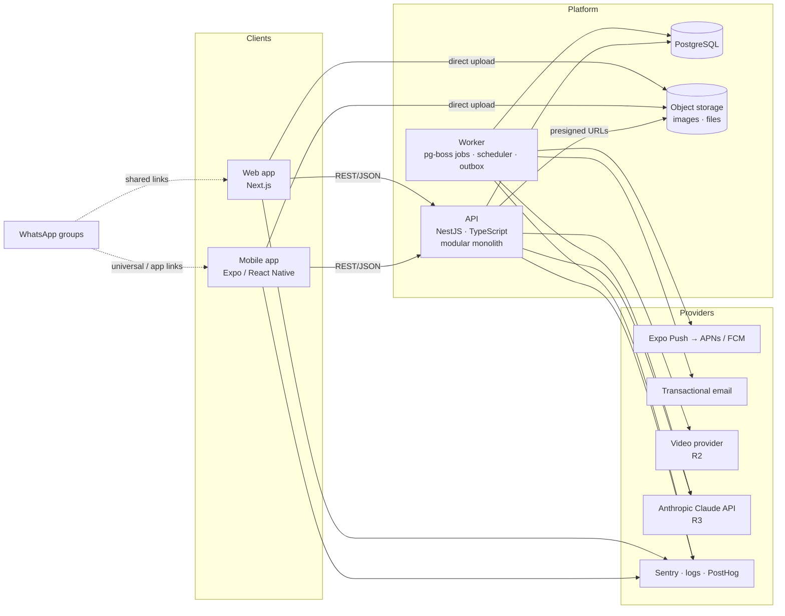

# Architecture Overview

> Status: **Proposed v0.1**. Every technology choice here is a recommendation to be confirmed in the [ADR log](adr-log.md) during R0. · Last updated: 2026-10-23
> Related: [Tech stack](00-tech-stack.md) (libraries and tools per app) · [Data model](02-data-model.md) · [API guidelines](03-api-guidelines.md) · [AI architecture](04-ai-architecture.md) · [NFRs](05-non-functional-requirements.md)

## 1. Drivers and constraints

| Driver | Consequence for the architecture |
|---|---|
| Two clients (iOS/Android app and web app) plus a server, built by a small team | One language end to end (**TypeScript**), a **monorepo** and shared contracts. |
| Mobile-first players on mid/low-end Android with limited data | A lean mobile app, offline-tolerant writes and compressed media. |
| WhatsApp is the entry point (links) | A web app that renders public pages server-side (rich link previews) and universal/app links. |
| Time-based features everywhere (reminders, digests, roll-call nudges, wellness cycles) | A reliable **scheduler and job queue**, idempotent jobs and an outbox. |
| Multi-tenant (clubs) with strict, role-based permissions | One central **authorization policy layer** and `club_id` on every tenant row. |
| Health-related data and minors | Data segregation, access logging, encryption, and minimization towards third parties ([Privacy](../product/06-privacy-and-compliance.md)). |
| Low budget per club (amateur market) | Managed services with free or cheap tiers, no per-player licensing costs, and a modular monolith instead of microservices. |
| Users in Uruguay and Argentina | Primary hosting region **São Paulo** (closest major cloud region; validate per provider). |

## 2. System context



## 3. Components

| Component | Responsibilities | Notes |
|---|---|---|
| **Mobile app** (`apps/mobile`) | Every role. Primary surface for players (agenda, RSVP, check-ins, plans, routines) and for staff field actions (create events, roll call, availability, quick capture, AI chat). | Expo (React Native) with Expo Router; EAS Build, Submit and Update; `expo-notifications` for push and actionable notifications; persisted query cache plus an offline mutation queue. |
| **Web app** (`apps/web`) | (1) **Staff portal**: setup, rosters, analytics, exercise library authoring, session planning, wellness board, content, AI. (2) **Public pages**: event link landing with rich previews, invite and claim landing, guardian consent, account-deletion info, legal pages. (3) A full player experience as a fallback for players who don't install the app. | Next.js App Router; server-rendered public pages; serves `apple-app-site-association` and `assetlinks.json`. |
| **API** (`apps/api`) | REST/JSON API for both clients; authentication, authorization and validation; domain logic; presigned uploads; AI orchestration. | **NestJS** on Node.js (Active LTS), TypeScript. One deployable, with one Nest module per bounded context (§ 4); guards for authorization; Prisma on PostgreSQL. |
| **Worker** (`apps/api`, worker entrypoint) | Outbox consumption, scheduled jobs (reminders, digests, wellness cycles, roll-call nudges, scheduled plan publishing, series materialization, data retention purges, account and club deletion), notification dispatch, media callbacks, async AI generations. | Same codebase and image as the API, run as a separate process type so it scales independently. Jobs run on **pg-boss** (ADR-006). |
| **PostgreSQL** | System of record. Also hosts the job queue (Postgres-backed) and full-text search (Spanish config + `unaccent` + `pg_trgm`). | Managed, with point-in-time recovery. |
| **Object storage** | Images, attachments and original uploads. Never public: access through signed URLs or a CDN with signed tokens. | S3-compatible. |
| **Video provider** (R2) | Upload, transcoding and adaptive streaming for exercise videos. | Managed provider (ADR-009). |
| **Push** | Delivery to iOS and Android. | Expo Push Service (ADR-008). |
| **Email** | Sign-in codes, guardian consent, critical fallbacks, account lifecycle. | Transactional provider with good LatAm deliverability. |
| **LLM** (R3) | Plan generation and chat. | Anthropic Claude API ([AI architecture](04-ai-architecture.md)). |
| **Observability** | Error tracking, logs, metrics, product analytics. | Sentry, structured logs, PostHog (no health data in analytics). |

## 4. Backend modules (bounded contexts)

| Module | Owns | Feature docs |
|---|---|---|
| `identity` | users, auth identities, sessions, devices, legal acceptances, consents, guardian requests | F01, F07 (consent) |
| `clubs` | clubs, categories, memberships, invite links, join requests, claim tokens, venues, admins/ownership | F02 |
| `events` | series, events, event categories, invitees, RSVP changes, roll call, share tokens, (R3) squad selection | F03 |
| `analytics` | read models and queries for attendance metrics | F04 |
| `training` | exercises, media, starter library, session plans, templates | F05, F06 |
| `wellness` | check-ins, pain reports, flags, schedules, access log | F07 |
| `content` | routines, nutrition plans, attachments, assignments, routine logs | F08 |
| `ai` | plan generations, conversations, tools, usage, quotas, pseudonymization | F09 |
| `notifications` | catalog, scheduling, delivery, inbox, preferences | F10 |
| `media` | presigned uploads, scanning, image variants, video provider integration | F05, F08 |
| `platform` | audit log, outbox, app config (minimum versions, flags), back-office endpoints | cross-cutting |

**Module rules**
- A module exposes a service interface and **domain events**. Other modules never touch its tables directly.
- Cross-module side effects (e.g. "membership started → add to future events") go through **domain events via the outbox**, so they survive crashes and retries.
- Pure domain rules (metric formulas, wellness flag rules, RSVP deadline logic, quiet-hours shifting) live in `packages/domain`, framework-free and fully unit-tested.

## 5. Repository layout (monorepo)

```text
.
├── apps/
│   ├── api/            # REST API + worker entrypoint
│   ├── web/            # Next.js: staff portal, public pages, player web fallback
│   └── mobile/         # Expo app
├── packages/
│   ├── contracts/      # Zod schemas, DTOs, enums → OpenAPI document
│   ├── api-client/     # Typed client generated from OpenAPI (web + mobile)
│   ├── domain/         # Pure business rules shared by API (and clients where useful)
│   ├── i18n/           # Message catalogs (es, en), ICU helpers, glossary-aligned terms
│   ├── ui-tokens/      # Design tokens (color, type, spacing) for web and mobile
│   └── config/         # tsconfig, eslint, prettier presets
├── docs/               # This documentation
└── .github/workflows/  # CI
```

## 6. Cross-cutting concerns

### 6.1 Authentication
- Sign-in with Google, Apple and email one-time codes (F01), through **Better Auth** running inside the API (ADR-007). On mobile, Google and Apple sign-in is native: the app sends the provider's ID token and the API verifies it.
- Sessions live in the database and are looked up on every request, so signing out of all devices takes effect on the next call. A session expires after 90 days without use (BR-AUTH-04). There are no refresh tokens to rotate.
- The mobile app keeps the session token in the Keychain / Keystore and sends it as a bearer token. The web app uses httpOnly, Secure, SameSite cookies, and Better Auth rejects cookie requests from untrusted origins.

### 6.2 Authorization
- A single policy module answers `can(actor, action, resource)` from the actor's current club and category memberships. It implements the [permission matrix](../product/02-personas-and-roles.md#4-permission-matrix).
- Every query is **scoped by `club_id`**. Repository methods require a club context argument, so an unscoped query cannot be written.
- Health-data reads (wellness, individual content) go through dedicated methods that also write the **access log** (BR-WELL-16).
- Every policy has backend tests, including cross-tenant negative tests ([NFR-SEC-03](05-non-functional-requirements.md)).

### 6.3 Multi-tenancy
- A shared database and schema, with `club_id` on every tenant-owned table, indexed and part of most composite indexes.
- Postgres Row-Level Security as defense in depth is **Later**: it can be added on the most sensitive tables (wellness) once the access patterns are stable.

### 6.4 Domain events, outbox and jobs
- Commands write their state change **and** an `outbox_events` row in the same transaction. The worker relays outbox rows to job handlers (at-least-once delivery), and handlers are idempotent.
- The scheduler uses **pg-boss**, a Postgres-backed queue (ADR-006), with jobs keyed by idempotency keys (`singletonKey`, BR-NOTIF-03).
- Example flow:
  1. `EventCreated` → compute the invitees.
  2. Schedule N-01, N-03 and N-08.
  3. At send time, re-check relevance (BR-NOTIF-04).
  4. Dispatch to Expo Push.
  5. Record receipts.

### 6.5 Time
- Instants are stored as `timestamptz` (UTC). Clubs have an IANA time zone. Wall-clock rules (series, quiet hours, check-in moments, digests) are evaluated in the club's time zone with a tz-aware library. Daylight-saving behavior follows BR-EVT-26.

### 6.6 Search
- Exercises: a Postgres full-text `tsvector` (Spanish config with `unaccent`) over name, description, coaching points and tags, plus structured filters. Members: trigram similarity on normalized names.
- Embeddings and semantic search are not needed for R2 or R3 (see [AI architecture § 5](04-ai-architecture.md#5-retrieval-strategy)).

### 6.7 Media pipeline
1. The client asks the API for an upload slot, and receives a presigned URL and constraints.
2. The client uploads directly to storage. Videos go to the video provider's direct-upload URL.
3. A storage or provider callback, or client confirmation, triggers verification (type, size), malware scan for documents, and variant generation (thumbnails, WebP).
4. The media record becomes `ready`. Clients receive signed URLs (short TTL) to read it.

### 6.8 Offline and sync (mobile)
- **Read**: a persisted query cache for the agenda, upcoming events, published plans, assigned routines and nutrition plans (BR-CONT-09).
- **Write**: an offline mutation queue for RSVP, roll call, wellness check-ins and routine logs. Every queued mutation carries an `Idempotency-Key`. Conflicts resolve last-write-wins by server receipt time; roll call is per invitee (BR-EVT-21).
- The UI always shows sync state: queued, syncing or failed with retry.

### 6.9 Deep links and link previews
- Public routes on the web domain: `/e/{shareToken}` (event), `/j/{code}` (invite), `/c/{claimToken}` (claim), `/consent/{token}` (guardian), `/delete-account` (info).
- iOS universal links and Android App Links open the app for the same paths when it is installed.
- Event and invite pages render Open Graph tags and a generated OG image (crest, title, date) for WhatsApp previews, never with personal data (EVT-07).

### 6.10 Internationalization
- Every user-facing string lives in `packages/i18n` (ICU MessageFormat). The default locale is Spanish (Río de la Plata variant, *voseo*), and English is added in R3 (AUTH-14).
- Push and email templates are localized server-side. Dates and times use 24 h format, with Monday as the first day of the week.

### 6.11 App versions and configuration
- Clients send `X-App-Version` and `X-Platform`. `GET /v1/app-config` returns minimum supported versions, feature flags and links.
- Requests from unsupported versions get `426 Upgrade Required`, and the app shows a blocking update screen.
- JS-only fixes ship through EAS Update (OTA) per channel. Native changes go through store releases.

### 6.12 Feature flags
- Club-level and user-level flags (DB-backed or the analytics tool's flags) gate pilot features, AI enablement and gradual rollouts. Flags are evaluated server-side and exposed through `app-config`.

### 6.13 Observability
- Sentry in all three apps (errors and performance), with release tracking per app version.
- Structured JSON logs that include `request_id`, `club_id` and `user_id`, and **never** health data, tokens or AI message content.
- Metrics and alerts: API error rate and latency, queue lag, notification delivery failures, AI error rate and spend ([NFR § Observability](05-non-functional-requirements.md#9-observability)).
- Product analytics: PostHog events defined in each feature doc. Health data and free-text content are never sent.

### 6.14 Back-office
- A minimal internal admin (protected and audited) for support tasks: account merges, data subject requests, starter-library management, club lookups. R1 can start with audited scripts; a proper UI arrives in R2 (TECH-12 in the [backlog](../delivery/backlog.md)).

## 7. Environments and delivery

| Environment | Purpose | Data | Mobile channel |
|---|---|---|---|
| Local | Development | Docker Compose Postgres, seed data | Development client |
| Dev / Preview | Integration, PR previews (web) | Synthetic seed | `preview` |
| Staging | Release candidate, QA, pilot rehearsal | Synthetic + anonymized samples | `staging` |
| Production | Live | Real | `production` |

- **CI** (GitHub Actions) runs lint, typecheck and backend tests (unit and integration against a real Postgres), builds every app and checks the OpenAPI contract.
- **CD** deploys the API and worker on merge to `main` → staging, then promotes to production by tag. Web uses preview deploys per PR. Mobile builds run on tags with EAS; OTA updates go per channel.
- **Database migrations** are forward-only and backward-compatible (expand → migrate → contract), run automatically on deploy.

## 8. Hosting proposal (to validate in R0)

| Piece | Candidate | Why |
|---|---|---|
| Web | Vercel | First-class Next.js support, preview deploys, edge caching for public pages. |
| API + worker | A container platform with a **São Paulo** region (e.g. Fly.io, AWS ECS/Fargate, Google Cloud Run) | Latency to Montevideo and Buenos Aires; separate process types. |
| PostgreSQL | Managed Postgres in São Paulo (e.g. Neon, Supabase, RDS) | PITR, branching for previews (Neon/Supabase). |
| Object storage | S3-compatible with cheap egress (e.g. Cloudflare R2) | Images and attachments are read often. |
| Video | Mux or Cloudflare Stream (ADR-009, R2) | Managed transcoding and adaptive streaming. |

Rough pilot cost, excluding AI and video: on the order of **US$100–250 per month**. This is an estimate to validate in R0, with the provider pricing of the time.
