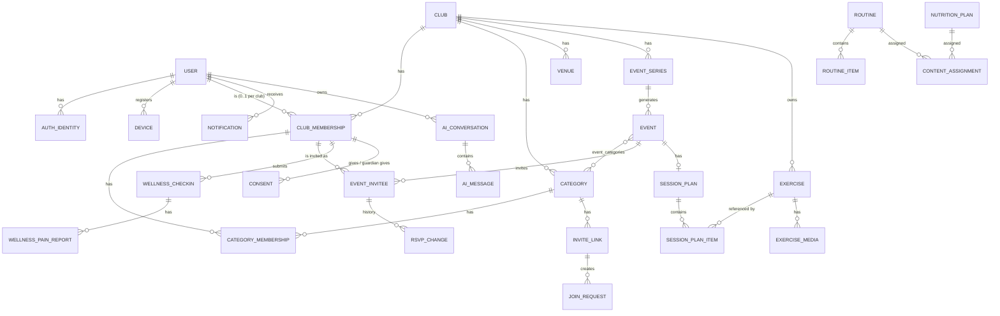

# Data Model

> Status: **Proposed v0.1** · Last updated: 2026-10-23
> This is a logical model. Exact column types and indexes are finalized in migrations. Names follow the [Glossary](../product/03-glossary.md).

## 1. Conventions

| Topic | Convention |
|---|---|
| IDs | UUID v7 (time-ordered) primary keys named `id`. Public tokens (share, invite, claim, consent) are separate random values and **stored hashed** when they grant access. |
| Tenancy | Every club-owned table has `club_id` (FK, indexed). A child of a club-owned row references it through a composite foreign key `(parent_id, club_id) → parent (id, club_id)`, so it can't point into another club. Starter-library rows use `club_id = NULL` with `source = 'starter'`. |
| Timestamps | `created_at` and `updated_at` (`timestamptz`, UTC) on every table. Local dates (`date`) only where the business rule is about a calendar day in the club time zone (e.g. `wellness_checkins.local_date`). |
| Soft delete | `archived_at` for user-facing archiving. `deleted_at` + `purge_at` for scheduled hard deletes (accounts, clubs). Hard deletes happen in purge jobs. |
| Enums | Text columns with check constraints (easier to evolve than native enums). The values are listed in the Glossary. |
| Audit | `created_by` / `updated_by` (user id) on mutable business tables. These and the other `*_by` user-id columns have no foreign key, so purging an account (BR-AUTH-12) leaves history intact. Columns that hold a membership id (`rsvp_set_by`) do have one. Sensitive changes are also written to `audit_log`. |
| Concurrency | A `version` integer on documents edited collaboratively (`session_plans`, `events`) for optimistic locking. |
| Sensitive data | **[H]** = health-related (special category). **[P]** = personal data. **[M]** = minor-related. See [Privacy § 2](../product/06-privacy-and-compliance.md#2-data-inventory-and-classification). |

## 2. Entity-relationship overview (core)



## 3. Entities by module

### 3.1 identity

**users** [P]
| Column | Type | Notes |
|---|---|---|
| email | citext unique | Verified primary identity (BR-AUTH-01). |
| email_verified | boolean | Better Auth requires a boolean. |
| name | text | The provider's display name, used to prefill profile completion (AUTH-05). Empty after an email-code sign-up. Required by Better Auth. |
| image | text null | Required by Better Auth and left empty: photos use `photo_key`. |
| first_name, last_name | text null | Required at profile completion (AUTH-05); null between first sign-in and completion. |
| nickname | text null | Display name source (BR-AUTH-07). |
| birthdate | date null | Required at profile completion, like the names. Minor status is derived from it (BR-AUTH-05). [M] |
| photo_key | text null | Object storage key. |
| phone | text null | E.164. |
| locale | text | Default `es`. |
| deletion_requested_at, purge_at | timestamptz null | BR-AUTH-12. |

Auth tables are Better Auth's models mapped to our names (ADR-007). It refuses to start if one of its columns is missing.

**auth_identities** (Better Auth `account`): `user_id`, `provider` (`google`, `apple`), `provider_subject`, plus Better Auth's provider-token columns, kept empty by a hook. Unique (`provider`, `provider_subject`). Email-code sign-in uses `users.email` and adds no row.

**auth_sessions** [P] (Better Auth `session`): `user_id`, `token` (unique, stored in **plain text**, an accepted risk under ADR-007), `expires_at` (moves forward with use; 90 days without use, BR-AUTH-04), `ip_address`, `user_agent`.

**auth_verifications** (Better Auth `verification`): `identifier`, `value`, `expires_at`. It holds the email codes, hashed, with their attempt count (BR-AUTH-03).

**devices**: `user_id`, `platform` (`ios`, `android`, `web`), `push_token` (unique when not null), `app_version`, `locale`, `last_seen_at`, `disabled_at`.

**legal_acceptances**: `user_id`, `document` (`terms`, `privacy`), `version`, `accepted_at`, `platform`.

**consents** [H][M]: `club_membership_id`, `type` (`wellness_health_data`), `version`, `granted_by` (`self`, `guardian`), `guardian_name`, `guardian_email`, `granted_at`, `revoked_at`, `evidence` (jsonb: IP, user agent, channel). The current consent is the latest non-revoked row for its type.

**guardian_consent_requests** [M]: `club_membership_id`, `guardian_name`, `guardian_email`, `token_hash`, `status` (`sent`, `accepted`, `expired`, `bounced`, `cancelled`), `sent_at`, `expires_at`, `decided_at`.

### 3.2 clubs

**clubs**
| Column | Notes |
|---|---|
| name, short_name, crest_key, primary_color, secondary_color | BR-CLUB-01 |
| country_code, timezone, default_locale | IANA time zone. |
| quiet_hours_start, quiet_hours_end | `time`. Default 22:00 and 08:00 (BR-NOTIF-01). |
| ai_enabled | bool, default true (BR-AI-02, OQ-14). |
| plan_tier | text (OQ-04). |
| deleted_at, purge_at | BR-CLUB-13. |

**categories**: `club_id`, `name`, `format`, `gender`, `age_group`, `color`, `min_players_practice`, `settings` (jsonb validated by a shared schema, see below; defaults to `{}`, and missing keys take the BR-CLUB-14 defaults), `archived_at`. Unique (`club_id`, `lower(immutable_unaccent(name))`) where `archived_at IS NULL` (BR-CLUB-02). `immutable_unaccent()` wraps `unaccent()` with a fixed dictionary, because Postgres only allows immutable functions in indexes.

`categories.settings` schema (defaults from BR-CLUB-14):
```jsonc
{
  "practiceDurationMin": 90,
  "matchDurationMin": null,          // null = format default: 105 (f11), 80 (f9, f8, f7), 60 (f5, futsal)
  "rsvpDeadlineOffsetMin": { "practice": 120, "match": 1440, "other": 120 },
  "lockAfterDeadline": false,
  "reminderOffsetsMin": { "beforeStart": [1440], "beforeDeadline": [60] },
  "weeklyAgenda": { "enabled": true, "weekday": 1, "time": "10:00" },
  "showAttendanceRanking": true,
  "wellness": { "enabled": false, "weekday": 1, "time": "09:00" }
}
```

**club_memberships** [P]
| Column | Notes |
|---|---|
| club_id, user_id (null for managed profiles) | Unique (`club_id`, `user_id`) where `user_id IS NOT NULL`. |
| is_owner, is_admin | Exactly one owner per club (partial unique index). |
| status | `active`, `removed`. |
| managed_first_name, managed_last_name, managed_nickname, managed_birthdate | Used only while `user_id` is null (BR-CLUB-11). |
| contact_email, contact_phone | Optional, staff-entered (BR-CLUB-07). |
| primary_position, secondary_positions (text[]), jersey_number, dominant_foot | AUTH-10. |
| joined_at, removed_at | |

**category_memberships**: `club_id`, `category_id`, `club_membership_id`, `staff_role` (`dt`, `coach`, null), `staff_title`, `is_player`, `starts_on`, `ends_on` (inclusive calendar dates in the club time zone; null = open; BR-CLUB-06). Check: `staff_role IS NOT NULL OR is_player`. The memberships of one person in one category never overlap, so at most one is open; `ends_on` may be the day before `starts_on` (a move effective on the first day leaves an empty membership). Index (`category_id`, `ends_on`).

**invite_links**: `club_id`, `category_id`, `role` (`player`, `coach`, `dt`), `token_hash`, `code` (unique, 6 characters), `requires_approval`, `expires_at`, `max_uses`, `uses_count`, `revoked_at`, `created_by`.

**join_requests**: `club_id`, `category_id`, `invite_link_id`, `user_id`, `requested_positions` (text[], copied to the club membership on approval), `possible_duplicate_of` (club membership id, null; BR-CLUB-10), `status` (`pending`, `approved`, `rejected`, `expired`, `cancelled`), `decided_by`, `decided_at`. One `pending` request per (`category_id`, `user_id`).

**ownership_transfers**: `club_id`, `from_membership_id`, `to_membership_id`, `status` (`pending`, `accepted`, `cancelled`, `expired`), `expires_at` (7 days, CLUB-12), `decided_at`, `created_by`.

**claim_tokens**: `club_membership_id`, `token_hash`, `expires_at`, `used_at`, `used_by_user_id`, `created_by`.

**venues**: `club_id`, `name`, `address`, `maps_url`, `lat`, `lng`, `notes`, `archived_at`.

### 3.3 events

**event_series**: `club_id`, `type`, `title`, `weekdays` (smallint[]), `local_start_time`, `duration_min`, `start_date`, `end_date`, `venue_id`, `notes`, `settings_snapshot` (jsonb), `created_by`.

**event_series_categories**: (`series_id`, `category_id`) PK, `club_id`. The categories of the series; new and extended instances are linked to them.

**events**
| Column | Notes |
|---|---|
| club_id, series_id (null for one-offs) | |
| type | `practice`, `match`, `other` |
| title, notes | |
| starts_at, ends_at, meet_at | `timestamptz` |
| venue_id, location_text | |
| opponent, home_away (`home`, `away`, `neutral`), competition | Matches only. |
| rsvp_deadline_at, rsvp_locked, reminders_enabled | `rsvp_deadline_at` and `meet_at` are recomputed from their offsets when the start changes (BR-EVT-13). |
| share_token | Unique, ≥ 10 random characters (EVT-07). Not secret-grade: it reveals only the public summary. |
| cancelled_at, cancelled_by, cancel_message | |
| is_backfill | EVT-20 |
| roll_call_completed_at, roll_call_completed_by | Drives `completed` vs. `attendance_missing` (derived). |
| overridden_fields | text[]: series instance overrides (BR-EVT-06). |
| version | Optimistic locking. |

Indexes: (`club_id`, `starts_at`); (`series_id`, `starts_at`).

**event_categories**: (`event_id`, `category_id`) PK, `club_id`.

**event_invitees** [P]
| Column | Notes |
|---|---|
| event_id, club_id, club_membership_id | Unique (`event_id`, `club_membership_id`). |
| source | `category`, `call_up`, `walk_in` (BR-EVT-02, BR-EVT-20). Category attribution for analytics is derived from category memberships on the event date ([F04 § 3.3](../features/F04-attendance-analytics.md#33-category-metrics-category-c)), not stored. |
| rsvp_status | `pending`, `going`, `not_going`. |
| rsvp_reason, rsvp_note | Reason required when `not_going`. Visible to staff only (BR-EVT-12). Note: `injury_illness` is treated as [H]. |
| arriving_late | bool |
| first_responded_at, responded_at, rsvp_is_late, rsvp_set_by | `rsvp_set_by` is the membership id of the staff member for proxies. |
| attendance_status | null, `present`, `late`, `absent`. |
| absence_justified | bool null (BR-EVT-19). |
| attendance_recorded_by, attendance_recorded_at | |
| removed_at | Soft removal from future events (BR-CLUB-05). |

Indexes: (`club_membership_id`, `event_id`); (`event_id`, `rsvp_status`).

**rsvp_changes**: append-only. `event_invitee_id`, `club_id`, `from_status`, `to_status`, `reason`, `arriving_late`, `source` (`app`, `push_action`, `web_link`, `weekly_agenda`, `proxy`, `system_reset`), `changed_by`, `changed_at`, `after_deadline`.

**squad_selections** (R3): `event_id`, `published_at`, `published_by`, plus `squad_selection_players` (`event_invitee_id`, `is_starter`).

### 3.4 training

**exercises**: every field in [F05 § 3](../features/F05-exercise-library.md#3-exercise-model-and-taxonomy), plus `club_id` (null for starter), `status`, `source`, `source_exercise_id`, `usage_count`, `last_used_at`, `search_vector` (generated `tsvector`), `created_by`, `archived_at`. Indexes: GIN on `search_vector`; GIN on `tags`, `equipment`, `game_moments`.

**exercise_media**: `exercise_id`, `club_id`, `kind` (`image`, `video`, `external`), `storage_key`, `provider_asset_id`, `playback_id`, `external_url`, `external_provider`, `thumbnail_key`, `duration_s`, `size_bytes`, `status` (`uploading`, `processing`, `ready`, `failed`), `sort_order`.

**session_plans**: `club_id`, `event_id` (unique, null for templates), `is_template`, `template_name`, `category_tags` (uuid[]), `objectives`, `published_at`, `publish_offset_min` (scheduled publish relative to start), `notify_on_publish`, `generated_by_ai`, `ai_generation_id`, `target_rpe`, `version`, `created_by`.

**session_plan_items**: `plan_id`, `club_id`, `block` (`warmup`, `main`, `cooldown`), `position`, `exercise_id` (null for ad-hoc), `adhoc_title`, `adhoc_description`, `duration_min`, `work_structure`, `intensity`, `group_label`, `player_notes`, `staff_notes`, `ai_suggestion` (jsonb, null unless AI-suggested).

**exercise_favorites** (R3): (`user_id`, `exercise_id`).

### 3.5 wellness

**wellness_checkins** [H][P]
| Column | Notes |
|---|---|
| club_id, club_membership_id | |
| submitted_at, local_date | Unique (`club_membership_id`, `local_date`) (BR-WELL-03). |
| load_level | smallint 1–5 |
| has_pain | bool |
| note | text ≤ 280 |
| flag | `red`, `amber`, `watch`, `ok`. Computed by `packages/domain` and stored. |
| edited_at | |
| consent_id | FK to the consent in force at submission. |
| extra_items | jsonb (R3: sleep, stress, soreness, mood). |

**wellness_pain_reports** [H]: `checkin_id`, `body_area`, `side`, `intensity` (0–10), `training_impact`.

**data_access_log**: `club_id`, `actor_user_id`, `subject_membership_id`, `resource` (`wellness_checkin`, `wellness_history`, `wellness_board_row`, `ai_tool`, `individual_content`), `context` (jsonb), `accessed_at`. Append-only, retained 24 months (BR-WELL-16).

### 3.6 content

**routines**: `club_id`, `title`, `goal_type`, `description`, `est_duration_min`, `weekly_frequency`, `created_by`, `archived_at`.
**routine_items**: `routine_id`, `position`, `exercise_id`, `adhoc_title`, `sets`, `reps`, `duration_s`, `load_text`, `rest_s`, `notes`.
**nutrition_plans**: `club_id`, `title`, `summary`, `content` (rich-text JSON), `author_credential`, `created_by`, `archived_at`.
**content_attachments**: `club_id`, `owner_type` (`routine`, `nutrition_plan`), `owner_id`, `storage_key`, `mime_type`, `size_bytes`, `scan_status` (`pending`, `clean`, `rejected`).
**content_assignments**: `club_id`, `content_type`, `content_id`, `category_id` **xor** `club_membership_id`, `starts_on`, `ends_on`, `created_by`, `ended_at`. Individual assignments count as [H] when the content is nutrition or `return_to_play`.
**routine_logs**: `club_id`, `routine_id`, `club_membership_id`, `performed_on`, `completion`, `rpe`, `comment`.

### 3.7 notifications

**notifications**: `user_id`, `club_id`, `type` (`N-xx` code), `entity_type`, `entity_id`, `payload` (jsonb, localized at send time), `idempotency_key` (unique), `scheduled_for`, `status` (`scheduled`, `sent`, `skipped`, `capped`, `failed`), `skip_reason`, `sent_at`, `read_at`.
**notification_deliveries**: `notification_id`, `channel` (`push`, `email`), `device_id`, `provider_ticket_id`, `status`, `error_code`, `attempt`, `attempted_at`.
**notification_preferences**: (`user_id`, `club_id`, `group`) PK, `enabled`.

### 3.8 ai

**ai_conversations**: `club_id`, `user_id`, `title`, `alias_map` (jsonb, encrypted at rest: alias ↔ membership id, BR-AI-07), `summary_state` (jsonb), `deleted_at`.
**ai_messages**: `conversation_id`, `role`, `content` (jsonb content blocks, including tool calls and results as sent), `created_at`.
**ai_plan_generations**: `club_id`, `user_id`, `event_id`, `category_id`, `input` (jsonb), `status` (`queued`, `running`, `succeeded`, `failed`), `versions` (jsonb[]: draft, warnings, rationale), `accepted_plan_id`, `feedback_rating`, `feedback_reason`, `feedback_comment`.
**ai_usage**: `club_id`, `user_id`, `feature` (`plan`, `chat`, `metadata`), `request_id`, `model`, `input_tokens`, `output_tokens`, `cache_read_tokens`, `cache_write_tokens`, `latency_ms`, `outcome`, `cost_estimate_usd`, `created_at`. Used for quotas (BR-AI-11) and cost reporting (BR-AI-13).

### 3.9 platform

**audit_log**: `club_id`, `actor_user_id`, `action`, `entity_type`, `entity_id`, `before`, `after` (jsonb, with sensitive fields redacted), `created_at`.
**outbox_events**: `type`, `payload`, `created_at`, `processed_at`, `attempts`, `last_error`.
**app_config**: minimum versions per platform, flags.

## 4. Key invariants (enforced in the database where possible)

| Invariant | Enforcement |
|---|---|
| One owner per club | Partial unique index on `club_memberships (club_id) WHERE is_owner`. |
| A category membership is staff or player | Check constraint. |
| Memberships of one person in one category never overlap, so at most one is open (BR-CLUB-06) | Exclusion constraint on (`category_id`, `club_membership_id`, inclusive date range), using `btree_gist`; check `ends_on ≥ starts_on − 1`. |
| One invitee row per person and event | Unique (`event_id`, `club_membership_id`). |
| `not_going` requires a reason | Check constraint. |
| One wellness check-in per person per local day | Unique (`club_membership_id`, `local_date`). |
| Content assignment targets exactly one of category or person | Check constraint (xor). |
| Exactly one plan per event | Unique `session_plans.event_id`. |
| Tenant consistency (child `club_id` = parent `club_id`) | Composite foreign keys `(parent_id, club_id) → parent (id, club_id)`, also on nullable parent columns. Service-layer checks plus tests only where a foreign key can't express it. |
| A row never moves to another club | Trigger `forbid_club_id_change` on every club-owned table. |

## 5. Derived data and performance

- Attendance metrics are computed **on read** with SQL over `event_invitees` joined with `events` in R1 (BR-ANL-05). If p95 exceeds the NFR target, add a `player_event_facts` table maintained by outbox handlers, or materialized views refreshed every 5 minutes.
- Wellness "current state" is the latest check-in per membership, using an index on (`club_membership_id`, `submitted_at DESC`).
- Search vectors are generated columns.
