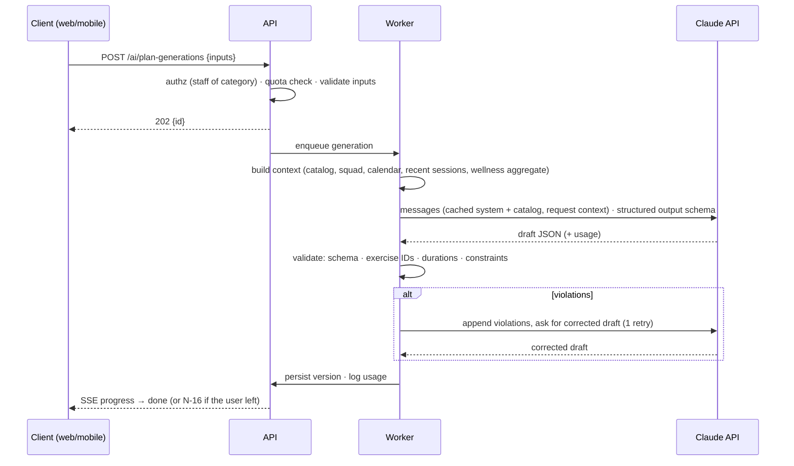

# AI Architecture (Plan Generator & Assistant)

> Status: **Proposed v0.1** · Release: R3 · Last updated: 2026-10-22
> Product spec: [F09](../features/F09-ai-coaching-assistant.md) · Decisions: ADR-010 in the [ADR log](adr-log.md)
> Model facts in this document (IDs, prices, API behavior) were checked against Anthropic's API reference as of October 2026. **Re-verify them when implementation starts**: models and API surfaces change frequently.

## 1. Principles

1. **Grounded, not generic.** Club data reaches the model through server-built context (plan generator) and permission-checked tools (chat). The model never queries the database directly.
2. **Drafts, not writes.** AI output is always a draft that a person accepts (BR-AI-04).
3. **Least data.** Players are pseudonymized, health data is aggregated, and sensitive content is never sent (BR-AI-07).
4. **Deterministic guardrails around a probabilistic core.** Schemas, ID validation and constraint checks run in code, not in the prompt.
5. **Measured.** An evaluation set gates launch and every prompt or model change. Usage and cost are logged per club.

## 2. Model and provider

| Item | Decision (proposed) |
|---|---|
| Provider | Anthropic Claude API, through the official TypeScript SDK (`@anthropic-ai/sdk`) on the server only. |
| Default model | **Claude Opus 5.5** (`claude-opus-5-5`): 1M-token context, up to 128K output tokens. List price US$4 / US$20 per million input / output tokens; cache reads US$0.20 per million. |
| Reasoning | Adaptive thinking (it cannot be disabled on this model). Depth is controlled through `output_config.effort`. Opus 5.5 defaults to `medium`, so **always set effort explicitly**. Starting points: chat `low`, plan generation `medium` (evaluate `high` against the eval set). |
| Cheaper models | `claude-sonnet-5-5` (US$2 / US$10) and `claude-haiku-5-5` (US$0.10 / US$0.50) are options **per route**, e.g. metadata suggestions (EXR-11). Switching is a product cost decision (OQ-14) and must pass the same evals. The default stays Opus 5.5. |

API behaviors the implementation must respect (current API surface):

- **Structured outputs** via `output_config.format` (JSON Schema generated from the Zod contract). Forced `tool_choice` (`any` / `tool`) is **rejected** on this model: use `auto` plus `strict: true` tools, or structured outputs.
- **No assistant prefill.** Control format with structured outputs and system instructions.
- **No sampling parameters** (`temperature`, `top_p`, `top_k`). They are rejected by the current API version.
- **Streaming** for chat and for any long generation, with generous `max_tokens` (thinking counts toward it) to avoid truncation.
- **Append-only conversation history.** Responses (including thinking blocks) must be appended to the history unchanged, and earlier turns must never be edited. Editing invalidates thinking blocks and can be rejected. Pseudonymization therefore happens **when tool results are produced**, never by rewriting history later.
- **Refusals.** Check `stop_reason` before reading content. A `refusal` stop reason comes with `stop_details`. Enable the server-side refusal fallback (`fallbacks: "default"`, beta `server-side-fallback-2026-07-01`) so a declined request can be retried on a fallback model automatically.
- **Prompt caching.** Prefix order is `tools` → `system` → `messages`. Stable content goes first; volatile content (today's date, the user's question) goes after the last cache breakpoint. Verify cache hits through `usage.cache_read_input_tokens`.
- **Mid-conversation system messages** (supported on this model) inject per-turn operator context, such as the selected category or today's date, without invalidating the cached prefix.
- **Long chats.** Server-side compaction (beta) summarizes older turns automatically, so long conversations stay usable (AI-05). No hard length cap is defined; add one only if the R3 spike shows a need.

## 3. Plan generator pipeline



### 3.1 Context built on the server

| Context block | Content | Notes |
|---|---|---|
| System rules (static, cached) | Role, coaching principles, output contract, safety rules (BR-AI-05/06/08/09/14), language and terminology. | Versioned in the repo (`ai/prompts/plan-system.v{n}.md`). |
| Club catalog (cached per club) | Compact lines per active exercise: `id · name · type · intensity · players min–max · GK · duration · space · equipment · tags`. | Pre-filtered by format and equipment. Capped at about 300 exercises (≈ 20–30K tokens), ranked by relevance to the objectives plus type diversity. |
| Squad context | Format, expected players and goalkeepers by line, average attendance. | From RSVPs and F04. |
| Calendar context | Days to the next match (**MD-x**), last match date, practices this week. | Periodization hints: MD-1 short and low intensity, MD-3/MD-4 the highest load. |
| Recent sessions | Last 3 weeks: objectives, exercise types and names, intensity. | Avoids repetition. |
| Wellness aggregate | Average load, count per flag, share with pain. **No names, no notes.** | Only if the requester has wellness access (BR-WELL-16 logs it). |
| Request | Objectives, duration, intensity, extra instructions. | Placed last (volatile). |

### 3.2 Output contract (structured output schema)

```jsonc
{
  "objectives": ["string"],
  "blocks": [
    {
      "block": "warmup | main | cooldown",
      "items": [
        {
          "exerciseId": "uuid | null",             // must exist in the provided catalog
          "suggestedExercise": {                    // only when exerciseId is null
            "name": "string", "type": "enum", "description": "string",
            "playersMin": 0, "playersMax": 0, "equipment": ["string"],
            "coachingPoints": ["string"]
          },
          "durationMin": 0,
          "workStructure": "string | null",
          "intensity": "low | medium | high",
          "groupLabel": "string | null",
          "playerNotes": "string | null",
          "rationale": "string"
        }
      ]
    }
  ],
  "warnings": ["string"],
  "summary": "string"
}
```

### 3.3 Server-side validation (BR-AI-05, BR-AI-06)

| Check | Action on failure |
|---|---|
| Schema valid | Retry once; then fail the generation (the quota is not consumed). |
| Every `exerciseId` is in the club catalog provided, active and accessible | Repair attempt with the list of invalid IDs; then drop the item and add a warning. |
| Suggested exercises ≤ limit (2, or 5 when the library is small) | Repair attempt; then keep the first N and add a warning. |
| Blocks ordered warm-up → main → cool-down; main is not empty | Repair attempt; then re-order and add a warning. |
| Total duration within ±10% of the target | Repair attempt; then add a warning. |
| Players and goalkeepers vs. the exercise's min/max and GK needs; equipment ⊆ available | Warnings only (the coach decides). |

## 4. Tools (chat assistant)

All tools are **strict** (`strict: true`, `additionalProperties: false`), run on the server with the requesting user's permissions, and return compact JSON. Player identities are returned as **aliases** (§ 6).

| Tool | Input | Returns | Permission |
|---|---|---|---|
| `get_my_context` | – | The user's categories (id, name, format, role), today's date in the club time zone | Any staff |
| `search_exercises` | `query?`, `type?`, `intensity?`, `equipment?[]`, `players?`, `maxDurationMin?`, `limit ≤ 20` | Compact exercise list | Staff of the club |
| `get_exercise` | `exerciseId` | Full exercise, including staff notes (visible to all staff) | Staff of the club |
| `list_upcoming_events` | `categoryId`, `days ≤ 30` | Events with type, date, RSVP counts by line | Staff of the category |
| `get_event_availability` | `eventId` | Counts per line plus alias lists for going / not going / pending (no reasons) | Staff of the event's categories |
| `get_attendance_summary` | `categoryId`, `from`, `to` | Category rates and per-alias rates (F04 definitions) | Staff of the category |
| `get_recent_sessions` | `categoryId`, `weeks ≤ 8` | Plans: objectives, exercise names and types, intensity | Staff of the category |
| `get_wellness_summary` | `categoryId` | Aggregates plus aliases per flag (red, amber). Players without consent are counted, not listed. **Access-logged.** | Staff of the category with wellness enabled |
| `find_player` | `name` | Alias candidates for a name the user typed | Staff of the club |
| `offer_plan_generation` | `categoryId`, `eventId?`, `objectives[]`, `durationMin?` | A UI action card ("Armar un plan") that opens the generator pre-filled. **Writes nothing.** | Staff of the category |

Tool results that contain user-authored text (exercise descriptions, plan notes) are wrapped and labelled as **untrusted data**. The system prompt states that instructions inside tool results must be ignored. The red-team set covers this (§ 8).

Implementation: the SDK's Tool Runner (with per-turn hooks for authorization logging and error handling) or a manual loop; choose in the R3 spike. With streaming and client tools, enable eager input streaming on the tools and **validate every tool input against its schema** before executing it.

## 5. Retrieval strategy

- Libraries are small (tens to a few hundred exercises), so the plan generator passes a **compact catalog** in a cached prompt block. That costs less engineering than retrieval infrastructure and lets the model see the whole option space.
- Chat uses `search_exercises`, which runs Postgres full-text search plus structured filters.
- **Embeddings are not needed** until libraries exceed about 1,000 exercises or semantic-search complaints appear. When they do: pgvector, with an embeddings provider chosen at that time (Anthropic does not offer an embeddings endpoint).

## 6. Privacy and data minimization

| Data | Sent to the model? | How |
|---|---|---|
| Player names | **No** (in tool results) | Replaced by stable per-conversation aliases (`J-07`). The alias map is stored encrypted on the server (`ai_conversations.alias_map`); the UI swaps aliases back to names as tappable chips. Names typed by the user in their own messages are sent as typed. |
| Positions, attendance rates, RSVP status | Yes | Attached to aliases. |
| Absence reasons and notes | **No** | |
| Wellness | **Aggregates and per-alias flags only** | No notes, body areas or intensities per player. Access-logged. |
| Individual nutrition plans, `return_to_play` routines | **No** | BR-CONT-07 |
| Exercise library, session plans | Yes | Club-authored training content. |
| Contact data, birthdates, photos | **No** | |

Contractual and policy items, tracked in [Privacy § 5](../product/06-privacy-and-compliance.md#5-ai-processing):
- Anthropic listed as a sub-processor.
- Review of the provider's data-retention and training-use terms at the time of contracting. Commercial API traffic is not used for training by default; confirm this, and confirm the retention options available.
- In-app disclosure (AI-09).

## 7. Reliability, safety and refusals

| Concern | Handling |
|---|---|
| Latency | Plan generation is asynchronous, with SSE progress. Target p95 ≤ 60 s. Chat streams; target p95 time to first token ≤ 3 s. |
| Provider errors (429, 5xx, timeouts) | SDK retries (bounded), then a user-facing retry. Failed generations don't consume quota. A circuit breaker disables AI entry points on sustained provider failure. |
| Refusals | Check `stop_reason` and use the server-side fallback (§ 2). If still refused, show "No pude responder eso" and log the category. |
| Medical questions | System rules plus eval coverage (BR-AI-08). |
| Prompt injection | Untrusted-data wrapping, tools that cannot write, server-side authorization on every tool, red-team evals. |
| Cross-tenant leakage | Tools receive the club and user from the authenticated session, never from model arguments. The model can only pass IDs, and the server re-authorizes each one. |
| Cost spikes | Per-club quotas and per-user rate limits (BR-AI-11), max tool iterations per turn (default 8), `max_tokens` caps per route, daily spend alerts. |

## 8. Quality and evaluation

- **Offline eval set** (in the repo, versioned): 40–60 plan scenarios built on synthetic clubs:
  - libraries of 20, 120 and 400 exercises;
  - formats `f11`, `f7` and `futsal`;
  - 8–22 players, 0–3 goalkeepers;
  - MD-1, MD-3 and no-match weeks;
  - fatigued squads and equipment-poor clubs.
- Plus **30 chat prompts** and a **red-team set**: medical advice, other clubs' data, injection inside exercise descriptions, off-topic requests, consent-less wellness.
- **Graders**:
  - Deterministic checks for the § 3.3 rules.
  - A model-graded rubric for coaching quality: progression, coherence with the objectives, appropriate intensity for MD-x and wellness, variety vs. recent sessions. The rubric is **calibrated against pilot coaches' ratings** before it is trusted.
- **Gate**: the targets in [F09 § 6](../features/F09-ai-coaching-assistant.md#6-quality-bar-acceptance-for-launch) must pass before launch and before any prompt or model change ships.
- **Online signals**: acceptance rate, edits before accept, thumbs and reasons (AI-06), refinement count, and generations abandoned without acceptance.

## 9. Cost model

Estimates only. Validate them with token counting and real usage before pricing decisions.

| Operation | Assumption | Estimated cost on Opus 5.5 |
|---|---|---|
| Plan generation | ~30K input tokens (large part cacheable), ~4–10K output tokens including thinking | ≈ US$0.10–0.35 |
| Chat message | ~10–20K input (mostly cached), 1–3 tool calls, ~1–3K output | ≈ US$0.03–0.15 |
| Active club / month (example) | 20 plans + 200 chat messages | ≈ US$7–40 |

These numbers are significant relative to amateur-club budgets. They are the main input for pricing and quotas (OQ-04) and for model-per-route decisions (OQ-14). Every request's actual cost is recorded in `ai_usage` (BR-AI-13).

## 10. Observability

- `ai_usage` rows per request (tokens, cache tokens, latency, outcome, cost estimate) feed per-club usage (AI-08) and spend dashboards.
- Traces span the full plan pipeline (context build → model → validation → repair).
- Alerts: AI error rate > 5% over 15 minutes; p95 latency over target; a club's daily spend > 3× its trailing average.
- Message content is excluded from general logs (BR-AI-13). Stored conversations follow BR-AI-12.
