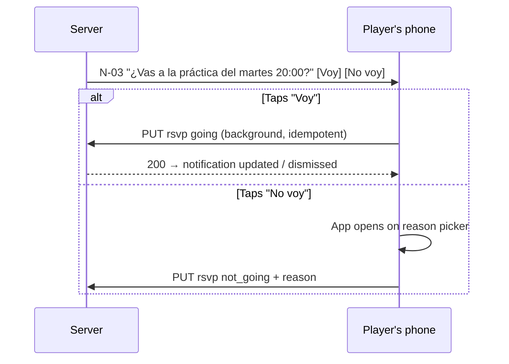

# UX: Information Architecture, Navigation & Key Flows

> Status: **Draft v0.1** · Owner: Product + Design · Last updated: 2026-10-22
> Related: [Product principles](../product/01-vision-and-strategy.md#5-product-principles) · [Glossary](../product/03-glossary.md) · [NFR: accessibility, localization](../tech/05-non-functional-requirements.md)

## 1. UX principles

1. **Two taps from notification to RSVP.** This is the most important interaction in the product. Prototype and test it first.
2. **Thumb-first mobile.** Primary actions in the lower half of the screen; one-handed use; big targets on field screens.
3. **Field-proof.** Roll call, availability and field mode work in sunlight, at night and on poor connections (NFR-A11Y-04, NFR-OFF-01).
4. **Answer the coach's question first.** Every staff screen opens with the answer ("Van 15: 2 ARQ, 5 DEF…") and the details come after.
5. **Empty states teach.** Every empty screen explains the next step and links to it (e.g. "Todavía no hay jugadores. Compartí este link en el grupo de WhatsApp").
6. **Club identity.** The club crest and primary color theme the header. Clubs care about their colors (R1 Should).
7. **Speak like the locker room.** Río de la Plata Spanish with *voseo*, short sentences and local football terms (§ 6).

## 2. Platform split

| Area | Players: mobile | Players: web | Staff: mobile | Staff: web |
|---|---|---|---|---|
| Sign-in, join, claim | ●●● | ●●● (link landings) | ●●● | ●●● |
| Agenda, RSVP, "Tu semana" | ●●● | ●● (fallback) | ●●● | ●● |
| Event create and edit | – | – | ●●● | ●●● |
| Availability and nudge | ● (view) | ● (view) | ●●● | ●● |
| Roll call | – | – | ●●● | ● |
| Club setup, categories, rosters | – | – | ●● | ●●● |
| Attendance analytics | ●● (own stats) | ● | ●● | ●●● |
| Exercise library authoring | – | – | ●● (quick capture) | ●●● |
| Session planning | ●● (view) | ● (view) | ●● | ●●● |
| Wellness check-in / board | ●●● (check-in) | ● | ●● (board) | ●●● |
| Routines and nutrition | ●●● (view, log) | ● | ● | ●●● (authoring) |
| AI assistant | – | – | ●● | ●●● |

●●● primary surface · ●● fully supported · ● basic or occasional · – not available

## 3. Navigation

### 3.1 Mobile: player-only users
Bottom tabs:
1. **Inicio**: "Mis pendientes" (RSVPs to answer, check-in, new routine), the next event card, the club switcher in the header and the inbox bell.
2. **Agenda**: upcoming events (list by day), "Tu semana", past events.
3. **Equipo**: squad list by category (positions, photos), my stats, ranking (if enabled).
4. **Entrenamiento** (R2+): published plans for my events, my routines, nutrition, exercises I can access.
5. **Perfil**: profile, player data per club, notifications, privacy (consents), settings, sign out.

### 3.2 Mobile: users with any staff role
Bottom tabs:
1. **Inicio**: staff dashboard:
   - next events with response counts and warnings;
   - "Falta pasar lista";
   - pending join requests;
   - wellness alerts (R2);
   - AI shortcut (R3).
   A "Mis pendientes" section appears too, if the user is also a player.
2. **Agenda**: the staff calendar for their categories, with a "+" button to create events.
3. **Plantel**: members per category, availability for the next event, wellness board (R2), stats.
4. **Entrenar** (R2+): library, plans and templates, routines and nutrition (R3), "Planificar con IA" (R3).
5. **Más**: AI assistant (R3), category settings, club (admins), profile and settings.

A **category selector** in the header filters staff tabs when the user has several categories ("Todas" is the default for the agenda).

### 3.3 Web: staff portal
Left sidebar: **Inicio** · **Calendario** · **Plantel** (categories, members, requests, invite links) · **Asistencia** (analytics) · **Estado físico** (R2) · **Biblioteca** (R2) · **Planificación** (plans and templates, R2) · **Rutinas** and **Nutrición** (R3) · **Asistente IA** (R3) · **Club** (settings, admins, venues, AI usage).
Top bar: club switcher, category filter, inbox, profile.

### 3.4 Web: public and player pages
- Public: `/e/{token}` (event landing), `/j/{code}` (invite), `/c/{token}` (claim), `/consent/{token}` (guardian), `/delete-account`, legal pages.
- Player web: a responsive equivalent of the mobile player tabs, with a persistent "Descargá la app para recibir recordatorios" banner.

## 4. Screen inventory

| # | Screen | Roles | Mobile | Web | Release | Stories |
|---|---|---|---|---|---|---|
| S-01 | Sign-in / sign-up | All | ✅ | ✅ | R1 | AUTH-01–04 |
| S-02 | Profile completion | All | ✅ | ✅ | R1 | AUTH-05, AUTH-10 |
| S-03 | Invite / claim landing | All | ✅ | ✅ | R1 | AUTH-06–09 |
| S-04 | Player home | Player | ✅ | ✅ | R1 | EVT-08, EVT-17, WELL-04 |
| S-05 | Staff home / dashboard | Staff | ✅ | ✅ | R1 | EVT-16, CLUB-06, CLUB-15 |
| S-06 | Agenda (list / month) | All | ✅ | ✅ | R1 | EVT-17 |
| S-07 | "Tu semana" | Player | ✅ | ✅ | R1 | EVT-18 |
| S-08 | Event detail + availability | All | ✅ | ✅ | R1 | EVT-08, EVT-11–13 |
| S-09 | Event create / edit (one-off, series, match) | Staff | ✅ | ✅ | R1 | EVT-01–06 |
| S-10 | Roll call | Staff | ✅ | ✅ | R1 | EVT-15 |
| S-11 | Club creation + onboarding checklist | Admin | ✅ | ✅ | R1 | CLUB-01, CLUB-15 |
| S-12 | Categories and settings | Admin, DT | ✅ | ✅ | R1 | CLUB-03, CLUB-04, CLUB-14 |
| S-13 | Members directory + member profile | Staff | ✅ | ✅ | R1 | CLUB-07–11 |
| S-14 | Invite links + join requests | Staff | ✅ | ✅ | R1 | CLUB-05, CLUB-06 |
| S-15 | Club settings, admins, venues | Admin | ✅ | ✅ | R1 | CLUB-02, CLUB-12, CLUB-13 |
| S-16 | My stats | Player | ✅ | ✅ | R1 | ANL-01, ANL-08 |
| S-17 | Category attendance dashboard + player table | Staff | ✅ | ✅ | R1 | ANL-02–07 |
| S-18 | Club overview | Admin | – | ✅ | R1 | ANL-09 |
| S-19 | Inbox | All | ✅ | ✅ | R1 | NOTIF-03 |
| S-20 | Settings: notifications, privacy, account | All | ✅ | ✅ | R1 | NOTIF-04, AUTH-12, AUTH-13 |
| S-21 | Exercise library (list, filters) | Staff | ✅ | ✅ | R2 | EXR-05, EXR-08 |
| S-22 | Exercise detail | All | ✅ | ✅ | R2 | EXR-06 |
| S-23 | Exercise editor / quick capture | Staff | ✅ | ✅ | R2 | EXR-01–04, EXR-07, EXR-09 |
| S-24 | Plan builder | Staff | ✅ | ✅ | R2 | PLAN-01–08 |
| S-25 | Plan view (player) | Player | ✅ | ✅ | R2 | PLAN-05 |
| S-26 | Wellness consent (player / guardian) | Player, guardian | ✅ | ✅ | R2 | WELL-01, WELL-02 |
| S-27 | Wellness check-in | Player | ✅ | ✅ | R2 | WELL-05, WELL-06 |
| S-28 | Wellness board + player history | Staff | ✅ | ✅ | R2 | WELL-08, WELL-09 |
| S-29 | Routines / nutrition (staff authoring) | Staff | ✅ | ✅ | R3 | CONT-01–03, CONT-07, CONT-08 |
| S-30 | My routines / nutrition | Player | ✅ | ✅ | R3 | CONT-04, CONT-05, CONT-09 |
| S-31 | AI plan generator + draft review | Staff | ✅ | ✅ | R3 | AI-01–03 |
| S-32 | AI chat + history | Staff | ✅ | ✅ | R3 | AI-04–07 |
| S-33 | AI usage & settings | Admin | – | ✅ | R3 | AI-08, AI-09 |
| S-34 | Force-update / maintenance screens | All | ✅ | ✅ | R1 | Architecture § 6.11 |

## 5. Key flows

### Flow A — A player joins from WhatsApp (app not installed)
1. The DT shares the category invite link in the team WhatsApp group (CLUB-05).
2. The player taps it, and the web invite landing opens: "Te invitan a **Primera** de **Club X**".
3. Sign-in: Google, Apple or email code. In in-app browsers, the email code is offered first (NFR-COMP-04).
4. Profile: name, birthdate, nickname and photo (optional), then position (AUTH-05, AUTH-10).
5. Pending approval (AUTH-08) or joined. The page offers the app download.
6. The player installs the app and signs in: the membership is already there, with upcoming events listed.

### Flow B — RSVP from a push notification (2 taps)

### Flow C — RSVP from the event link
1. The DT shares the event link (EVT-07). The WhatsApp preview shows the crest, "Práctica Primera · mar 14/10 20:00 · Parque Rodó".
2. Tapping it opens the app if installed (universal / app links); otherwise the web landing opens.
3. Signed in: Voy / No voy plus availability. Signed out: event summary and sign-in, then back to the RSVP buttons (EVT-10).

### Flow D — The DT's Sunday-night check
1. Staff home → the next event card shows "Van 12 · No van 3 · Sin responder 9 · ⚠️ Sin arquero".
2. Open availability, grouped by line (EVT-11). From R2, wellness flags appear next to names (WELL-10).
3. "Recordar a los que no respondieron" (EVT-13). Managed profiles: "Copiar lista" → paste in WhatsApp.
4. Optionally call up two *Sub-20* players (EVT-06).

### Flow E — Roll call at the field
1. From the event card (roll call opens 30 minutes before the start, BR-EVT-17), or from the N-08 reminder at the end + 15 min, the DT opens "Pasar lista".
2. The list is pre-filled from RSVPs. The DT adjusts the exceptions with one tap each (present → late → absent).
3. A walk-in is added with "+ Agregar".
4. Save. Offline: the change is queued, and the screen shows "Se enviará cuando haya conexión" (EVT-15).

### Flow F — The weekly ritual "Tu semana" (R2)
1. Monday 10:00: N-02 "Tu semana: 3 actividades + check-in".
2. Step 1, check-in: load, then pain no/yes and details (WELL-05).
3. Step 2, confirm the week: Voy / No voy per event, or "Voy a todo" (EVT-18).
4. Done screen: "Listo. Nos vemos el martes ⚽".

### Flow G — Plan a practice with AI (R3)
1. The practice has no plan; the staff home suggests "Planificá la práctica del martes con IA".
2. Form pre-filled with category, duration, expected players (from RSVPs) and MD-x. The coach adds objectives, e.g. "presión tras pérdida".
3. Progress, then the draft opens in the plan builder with rationale, warnings and exercise links (AI-01).
4. The coach refines ("más corto, sin arcos grandes") (AI-02), edits, then "Usar este plan" (AI-03) → publish to players (PLAN-04).

## 6. Voice and tone

| Situation | Guideline | Example (es) |
|---|---|---|
| Calls to action | Imperative with *voseo*, ≤ 3 words | "Confirmá", "Pasar lista", "Compartir" |
| RSVP | Use the words players already use | "Voy" / "No voy" / "Llego tarde" |
| Confirmations | Short, warm, football flavor allowed | "¡Listo! Te esperamos el martes." |
| Warnings | Factual, with the fix | "Sin arquero confirmado. Invitá a un arquero de otra categoría." |
| Errors | Say what happened and what to do; no blame, no codes | "No pudimos guardar tu respuesta. Lo intentamos de nuevo cuando vuelva la conexión." |
| Health-related | Calm, respectful, non-alarming; always mention professional advice for severe pain | "Si el dolor es fuerte o no mejora, consultá a un médico o fisio." |
| Empty states | Explain the value and the next step | "Todavía no hay ejercicios. Copiá algunos de la Biblioteca base para empezar." |

Avoid English loanwords where a common Spanish term exists ("práctica", not "training"). Use the glossary terms consistently.

## 7. Visual design notes

- **Design tokens** in `packages/ui-tokens`, shared by web and mobile: color, typography, spacing and radius.
- **Status colors always paired with an icon and a label** (NFR-A11Y-03): Voy green ✓, No voy red ✕, Sin responder grey ?, wellness flags 🔴🟠🟡🟢⚪.
- **Club theming**: club primary color as an accent (header, active tab) with automatic contrast checks; crest in the header.
- **Dark mode** (Should, R1): much usage happens at night.
- **Field mode / high contrast** for roll call and plan field mode.
- **Charts**: simple and labelled, always with numerator and denominator (BR-ANL-04).

## 8. Design deliverables before R1 development

1. Clickable prototype of Flows A, B, C, D and E (mobile) plus the event link landing (web), tested with at least 5 players and 3 DTs.
2. Design system foundations (tokens, typography, core components) for both platforms.
3. High-fidelity designs for screens S-01 to S-20 and S-34.
4. Push notification and email templates (es) for N-01 to N-10 and N-18 to N-21.
5. Store assets plan (icon, screenshots, descriptions) for the pilot builds (TestFlight / internal testing).
